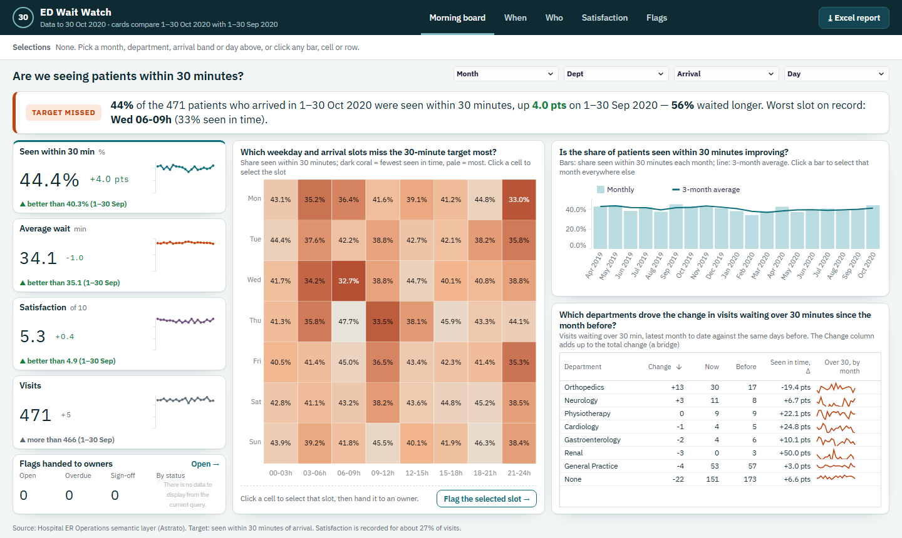
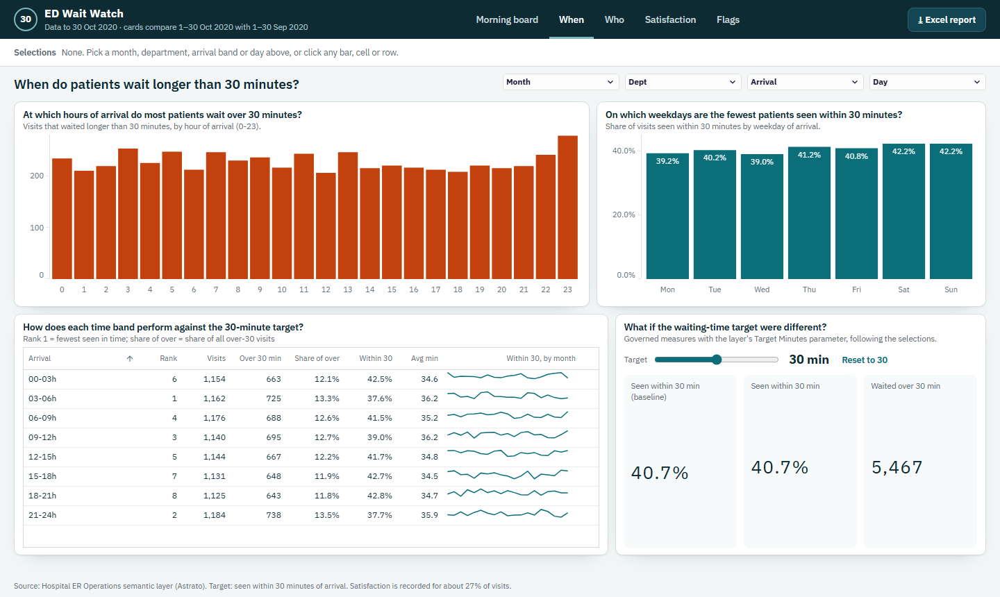
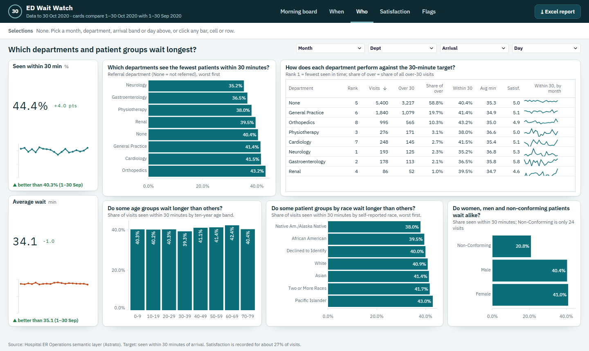
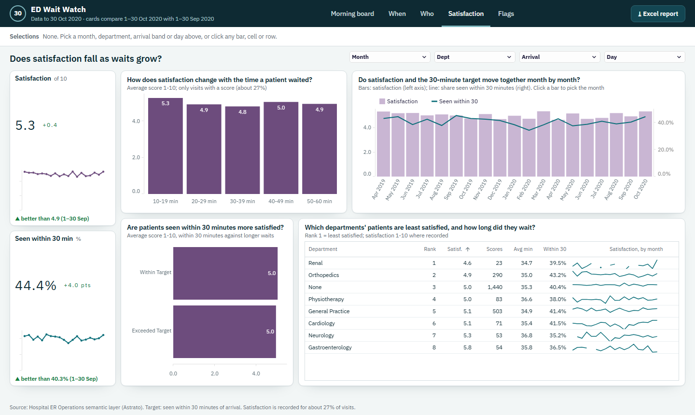
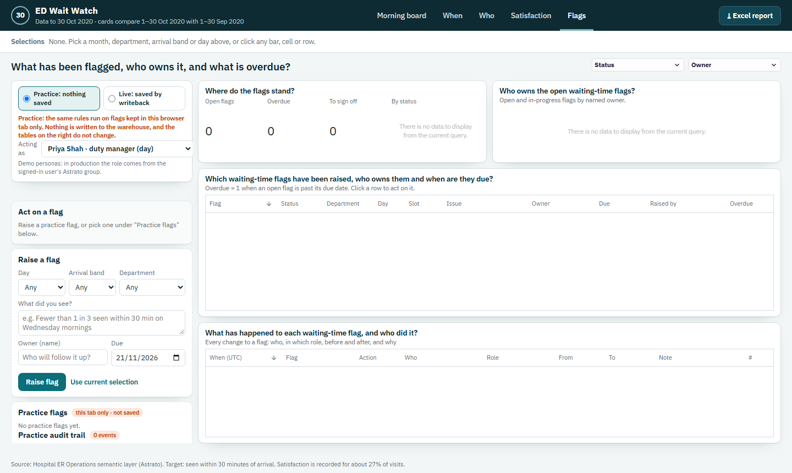

# ED Wait Watch — the morning waiting-time board

An emergency department's ED operations lead and duty managers ask every morning: *are we seeing
patients within 30 minutes, where and for whom are we not, and who is following it up?* The app
walks from the board, to when patients wait, to who waits, to whether waiting hurts satisfaction,
to flags handed to named owners and signed off. In the screenshots 44% of the 471 patients who
arrived in 1–30 Oct 2020 were seen within 30 minutes, up 4.0 points on 1–30 Sep, so 56% waited
longer; the worst slot on record is Wednesday 06-09h (33% seen in time); average wait fell from
35.1 to 34.1 minutes; and Orthopedics drove the largest rise in visits waiting over 30 minutes
(+13, 30 against 17).

**This example was scored by an independent judge at 45/52** ([SCORE.md](SCORE.md)) and admitted,
with no gate at 0. The judge's main gaps are listed under [Caveats](#caveats).

**The first monitor among the examples**, and an example of **governed writeback with a practice mode**.
Flags are written in Live mode to two workflow tables (records and audit events) behind two layer
views; Practice mode, the default, runs exactly the same rules on flags kept in the browser tab and
writes nothing. Public sample data: a public hospital emergency-room sample dataset, Apr 2019 – Oct 2020. A
hand-written Astrato App on Vite and the public `@astrato-io` packages (visualizations 0.9,
app-runtime 0.9).

<p>
  
  
  
  
  
</p>

## Tabs

Above every tab: the data-to date and the comparison window (*cards compare 1–30 Oct 2020 with
1–30 Sep 2020*) and **Excel report** in the masthead; a sticky selection line (chips, ×, Clear
all, a hint, and chips that do not apply on the current tab greyed with a reason); and the Month,
Dept, Arrival and Day dropdowns beside the tab's question (Status and Owner on Flags).

- **Morning board** — a headline from stored measures with a verdict (Target missed, or Most seen in time), the comparison and the worst slot; four KPI cards (seen within 30 min with its change in points, average wait, satisfaction, visits), each against the same days of the month before, coloured by whether the move is good, with a monthly mini line; the flag counts; a weekday × arrival-band heat map (click a cell, then *Flag the selected slot*); the monthly share seen in time with a 3-month moving average (click a bar to select the month); a drivers bridge of the departments behind the change in visits waiting over 30 minutes.
- **When** — over-target visits by hour of arrival; share seen in time by weekday; an arrival-band table with rank, share of all over-target visits, average wait and a trend column; a **what-if** on the target itself (15–45 minutes) beside a governed 30-minute baseline.
- **Who** — two KPI cards for the selection; departments worst first; a department table with rank, share of over-target visits, wait, satisfaction and trend; age band, race and gender.
- **Satisfaction** — two KPI cards; satisfaction by 10-minute wait band; within against over target; satisfaction (bars) and share seen in time (line) month by month; departments ranked by satisfaction with a trend column.
- **Flags** — Practice or Live mode and *Acting as*; raise a flag on a weekday / arrival-band slot or a department with what was seen, a named owner and a due date; act on a selected flag (start, resolve, reassign, sign off, reopen); flag counts, owners of open flags, the flag list and the audit trail as native tables over the writeback views.

## The flag workflow: Live and Practice

**Rules, one function for both modes.** `decide(action, flag, actor, note)`
([workflow.js:48](project/src/workflow.js#L48)) allows or refuses each move with a reason: anyone
raises; an open flag is started, resolved or reassigned; only an ED operations lead signs off or
reopens; **four eyes**: nobody signs off a flag they raised or resolved (the resolver is read from
the audit trail); a note is required to resolve, reassign or reopen. Every action button is always
shown, and a refused one says why. Both modes go through the same path: check the rule, then
record the change ([workflow.js:125](project/src/workflow.js#L125)). *Acting as* switches between
four demo personas, two duty managers and two leads ([workflow.js:28](project/src/workflow.js#L28)).

**Live mode** writes through governed writeback (`app.writeback`): a flag is a row in the records
view and every change is a row in the audit-events view (who, role, action, before, after, note,
when). An update that changed no row is an error ([workflow.js:106](project/src/workflow.js#L106),
the event insert at [workflow.js:115](project/src/workflow.js#L115)); after each write the app
clears its query cache and remounts only the flag objects
([app.js:579](project/src/app.js#L579)), so the native flag tables show the change. Live is
offered only when the runtime can write ([workflow.js:96](project/src/workflow.js#L96)).

**Practice mode** (the default, labelled "nothing saved") runs the same rules on flags kept in the
browser tab's `sessionStorage`, with a practice audit trail that also lists refused attempts and a
*Reset practice* ([workflow.js:120](project/src/workflow.js#L120)). Nothing is written and the
native flag tables do not change. The app's own workflow check drives it through the UI (raise,
start, resolve without a note (refused), resolve, self sign-off (refused, four eyes), duty manager
sign-off (refused), another lead signs off, reset) and asserts that no writeback call was made
([app.js:754](project/src/app.js#L754)).

## Worth copying

**The comparison window comes from the data.** The KPI cards compare the latest month to date
with the same days of the month before, through the layer's Review Month axis and its This Month
/ Last Month / Change measures ([catalogue.js:30](project/src/catalogue.js#L30)). The app reads
the latest month with visits and its last day to write *1–30 Oct 2020 with 1–30 Sep 2020* in the
masthead, captions and Excel ([app.js:286](project/src/app.js#L286)); with a month selected, that
month is compared with the one before ([app.js:310](project/src/app.js#L310)). See the first
caveat for where this falls short.

**Text never shows one selection's words beside another's numbers.** On every selection change the
headline and KPI captions switch to "Updating…" at once ([app.js:335](project/src/app.js#L335)),
and only the read for the current selection may fill them ([app.js:347](project/src/app.js#L347)).
Those reads jump the query queue ([throttle.js:31](project/src/throttle.js#L31)).

**A drivers bridge as a native table.** For each department: visits over target now, before, and
the change, sorted by change, with a seen-in-time points change and a trend column; the changes add
up to the total ([catalogue.js:78](project/src/catalogue.js#L78)).

**What-if on the target.** A 15–45 minute slider ([app.js:451](project/src/app.js#L451)) sets the
layer's `Target Minutes` parameter on two native numbers with `setMeasureDefinedParameter` through
`applyRuntimeOperations`, no remount ([app.js:464](project/src/app.js#L464)); the 30-minute
baseline is a separate, parameter-free object and stays put.

**Every object on a stored question.** 45 data objects over 33 of the layer's 37 stored questions,
declared once as data ([catalogue.js:52](project/src/catalogue.js#L52)) with the question as the
card title, and turned into definitions and operations by [tiles.js](project/src/tiles.js)
([tiles.js:171](project/src/tiles.js#L171)); the 3-month average travels as a moving-calculation
operation ([tiles.js:116](project/src/tiles.js#L116)).

Also useful:
- pending clicks applied after 200 ms in every group, with the visible tab's applied state mirrored into one app-wide selection; the trend's group never takes the month, so it keeps every month ([app.js:430](project/src/app.js#L430), the mirror at [app.js:146](project/src/app.js#L146));
- every tab mounted at load through four lanes, the visible tab first ([app.js:275](project/src/app.js#L275)), inactive panes off-screen rather than `display: none` ([styles.css:58](project/src/styles.css#L58));
- a query lane with 429 and 502/503/504 backoff, timeouts and a session cache ([throttle.js:117](project/src/throttle.js#L117));
- table widths refitted on window resize with width operations, no remount ([app.js:273](project/src/app.js#L273));
- a seven-sheet Excel report (Summary, When, Who, Satisfaction, Flags, Data, Definitions) that follows the selections ([export.js:21](project/src/export.js#L21), [export.js:53](project/src/export.js#L53));
- 15 self-checks the smoke test runs, including the stale-text check, two empty-state edges and the Practice workflow ([app.js:627](project/src/app.js#L627)).

## Semantic layer

[`layers/hospital-er-operations`](../../layers/hospital-er-operations/) ("Hospital ER
Operations"): 3 views, no joins, 40 dimensions, 38 measures and 37 stored business questions.

- **Views:** ER Visits (one row per visit, a public hospital emergency-room sample dataset); Er Wait Flags (one row per flag) and Er Wait Flag Events (one row per change), the two writeback views. The flag views are not joined to visits.
- **Dimensions used:** Arrival Month, Period, Arrival Day, Time Band, Hour of Day, Department Referral, Age Band, Race Group, Gender, Wait Band, Wait Target, and the flag fields (status, owner, department, slot, due date, raised by; event time, actor, role, action, from, to, note).
- **Measures used:** Seen Within Target % (with a `Target Minutes` parameter), Patients, Patients Over Target, Share of Over-Target Patients, Avg Wait Time, Avg Satisfaction, the This Month / Last Month / Change vs Last Month families on the Review Month axis (within %, wait, satisfaction, visits, patients over target, and a points change), two rank-basis measures, and the flag counts.
- **Questions:** 33 of the 37, e.g. *What share of patients were seen within 30 minutes this month, and how many points did it move?*, *Which weekday and arrival slots miss the 30-minute target most?*, *Which departments drove the change in visits waiting over 30 minutes since the month before?*, *How does satisfaction change with the time a patient waited?*, *What has happened to each waiting-time flag, and who did it?* Full list in [questions.md](../../layers/hospital-er-operations/questions.md).
- **Modelling choice:** Arrival Day sorts Monday first by putting invisible zero-width spaces in front of the later day names; a filter search for "Wed" still matches, and the Excel sheets strip them.

## Rebuild from nothing

1. **Data.** Load the visit table shaped like [`schema/ddl.sql`](../../layers/hospital-er-operations/schema/ddl.sql) from a public hospital emergency-room sample dataset (see DATA-SOURCES.md), and create the two empty workflow tables (records and audit events) beside it; No data is shipped: once your table is loaded, profile the layer over MCP ([playbook step 1](../../playbook/1-read-the-layer.md)) to see each dimension's values.
2. **Layer.** Recreate it from [`layer.json`](../../layers/hospital-er-operations/layer.json), pointing the three views at your tables, enable writeback on the two flag views, and publish it.
3. **App.** See Run it.

## Run it

```sh
cd project
npm install                # public npm: @astrato-io/app-runtime, @astrato-io/visualizations, vite
# set semanticLayerId in astrato.json to your copy of the layer (it ships as a zero placeholder)
astrato login
npm run compile-check      # all 63 objects compile against the installed library, no session needed
astrato dev .              # open the sign-in URL it prints
node ../../../kit/verify/smoke.mjs "<that sign-in URL>" --widths 1440,1280,1024
astrato build .
```

The checks never write: run Live mode yourself to try writeback. [docs/brief.md](project/docs/brief.md)
and [docs/data-brief.md](project/docs/data-brief.md) are the agent's own brief and data brief from
the build; [SCORE.md](SCORE.md) is the judge's scorecard.

## Caveats

The judge's main gaps first ([SCORE.md](SCORE.md), 45/52):

- **The comparison window can be mislabelled under a selection.** The Review Month axis ends at the latest day *in the filtered rows*, but the captions are written from the unfiltered last day ([app.js:286](project/src/app.js#L286)). With Department = Renal the cards compare 1–9 Oct with 1–9 Sep while saying 1–30; Wed 06-09h computes 1–28 Sep (3 visits, 33.3%, where 1–30 Sep has 4 and 25.0%).
- **The headline's worst slot is chosen in the app** (the lowest share among slots with at least 30 visits, [app.js:388](project/src/app.js#L388)), not by a stored top-N question.
- **The flags are not joined to visits:** visit filters do not narrow the flag views, and the Flags tab has only its own Status and Owner filters.
- **Legibility at 1440:** "+100.0 pts" clips under a mini line (Renal); the *Acting as* select overflows its card and its label wraps; the empty *By status* mini chart shows the library's small grey text; "No comparison for 1–30 Mar" lacks a year; copy nits ("unchanged than", "±0.0 ▼ worse" from rounding).
- **At 1024** table cells end in ellipses, headers wrap mid-word, the Flags table drops its Overdue column and the *Acting as* select overflows; there is no horizontal page scroll.
- **Board selections settle in 3.8–4.8 s** under the judge's real clicks (other tabs 1.9–4.1 s); the five app-text reads run on every selection.
- **Live writeback is untested:** neither the judge nor the app's checks wrote to the warehouse. Hosted viewers may not be able to write; Live is then disabled and Practice remains.
- The app's selection checks put pending selections from code, not pointer events; the judge's real clicks worked at 1440×860.

Also:

- **Public sample data.** Apr 2019 – 30 Oct 2020 (31 Oct missing); satisfaction is recorded for about 27% of visits; small groups swing a lot. Not live.
- The flag tables start empty and are shared by everyone using the layer; the screenshots show them empty.
- Four demo personas in *Acting as*; in production the role would come from the signed-in user's group.
- Checked by the judge: the kit smoke passed at 1440, 1280 and 1024 (63 objects rendered, 15 app checks, 0 console errors, 0 failed requests, landing-ready 3.5 s), and the four board KPIs reconciled with MCP queries unfiltered, with Department = Orthopedics and with Month = Jun 2020. **Not published**, so no live smoke.
- Runs on `@astrato-io/visualizations` 0.9.0 and `app-runtime` 0.9.0 with Vite.
- `astrato.json` carries a zero placeholder `semanticLayerId`; `layer.json`'s datasource is a placeholder too.

## Data source and licence

See [DATA-SOURCES.md](../../DATA-SOURCES.md) for where this example's data comes from and on what terms.
