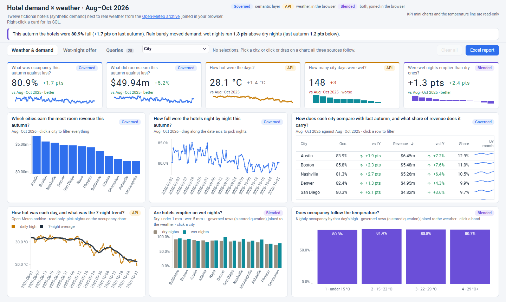
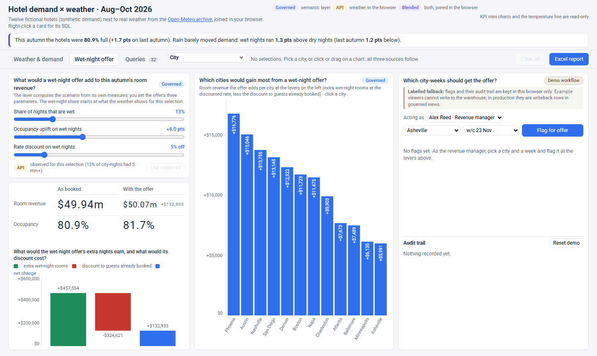
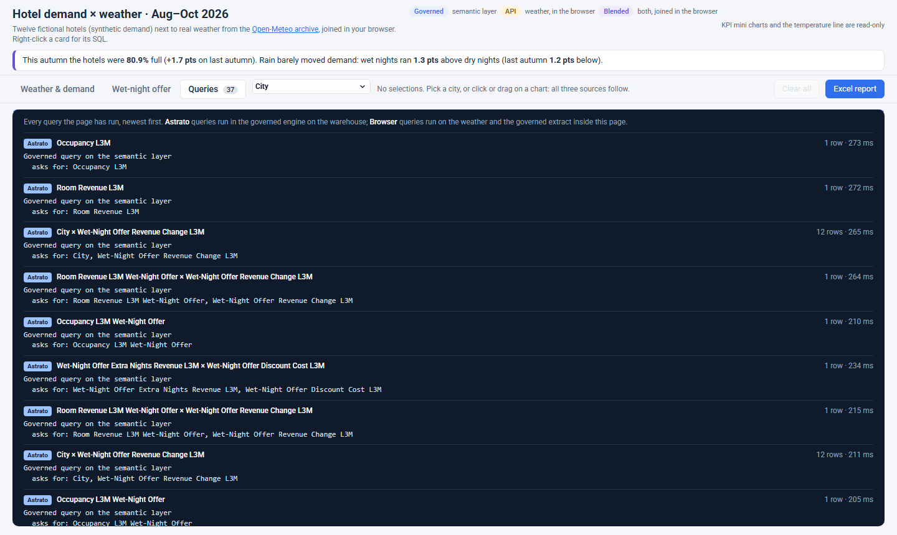

# Hotel Demand × Weather — governed demand blended with a public API

**The first data-blending example.** Three sources feed one page, and every chart, KPI
and table on it is a native Astrato object on **one Astrato selection**:

- **Governed:** hotel demand from the semantic layer, on the Astrato engine.
- **API:** real daily weather for the twelve hotel cities, read from the public
  [Open-Meteo](https://open-meteo.com/) historical archive by **DuckDB-WASM in the browser**.
- **Blended:** the rows of one stored question (occupancy by city and night) copied into DuckDB and
  joined to the weather on city and date ([duck.js:71](project/src/duck.js#L71)).

A city click, a table row or a temperature band moves all three. A hotel revenue manager asks:
*does rain move demand enough to run a discounted wet-night offer, and where?* In the screenshots
the hotels were 80.9% full this autumn (Aug–Oct 2026), +1.7 pts on last autumn, with $49.94m room
revenue (+5.2%); there were 148 wet city-days (+3) at an average high of 28.1 °C; wet nights ran
1.3 pts *above* dry nights (last autumn 1.2 pts below), so rain barely moved demand; and the
default offer (13% wet nights as observed, +6 pts uplift, 5% off) adds $132,933, most in Phoenix
(+$16,776).

**This example was scored by an independent judge at 46/52** ([SCORE.md](SCORE.md)) and admitted,
with no gate at 0. The judge's main gaps are listed under [Caveats](#caveats).

The hotels belong to **Harbourline Hotels**, a fictional group; their demand is synthetic. The
weather is real: *weather data by [Open-Meteo.com](https://open-meteo.com/), CC BY 4.0*, fetched
live on every load (no key; the API answers with CORS `*`). A hand-written Astrato App on Vite and
the public `@astrato-io` packages (visualizations 0.9, app-runtime 0.9) plus `@duckdb/duckdb-wasm`.

<p>
  
  
  
</p>

## Tabs

Above every tab: the source key (Governed, API, Blended), the Open-Meteo credit, a headline
sentence that follows the selection ([app.js:395](project/src/app.js#L395)), and one bar with the
tabs, the City filter, chips with ×, **Clear all** and **Excel report**.

- **Weather & demand** — five KPIs against Aug–Oct 2025, each with a native mini chart: occupancy and room revenue (governed), average high and wet city-days (API), wet vs dry nights (blended); revenue by city; occupancy night by night (drag along the date axis to pick nights); the city table with occupancy, room revenue, both changes, share and a by-month sparkline column; the daily high with its 7-night average; occupancy on dry and wet nights by city; occupancy by temperature band (click a band).
- **Wet-night offer** — three levers on the layer's parameters: share of nights that are wet (starts at what the weather shows for the selection), occupancy uplift on wet nights, rate discount; room revenue and occupancy as booked beside the scenario; a waterfall of the extra nights' revenue against the discount on guests already booked; the gain by city; then the one recorded action, a city-week flagged by the revenue manager and approved or rejected by a general manager, nobody deciding their own flag, with an audit trail and reset. Browser-only, and labelled so.
- **Queries** — every statement both engines ran, newest first ("Astrato" for governed, "Browser" for DuckDB). Right-click any card for its SQL.

## Worth copying

**The blend, built from governed rows.** At boot the app fetches the weather into DuckDB
([duck.js:38](project/src/duck.js#L38), the request in [weather-source.js:20](project/src/weather-source.js#L20))
while it runs one governed query, the stored question *How full was each city night by night, this
autumn and last?* ([app.js:297](project/src/app.js#L297)). Those rows go into DuckDB as a `demand`
table and are joined to the weather on city and date ([duck.js:71](project/src/duck.js#L71)). Rain
and temperature bands are worked out on the weather rows ([duck.js:56](project/src/duck.js#L56)),
so a band narrows API and blended charts alike. Every demand figure in the blend is a governed
figure; only the weather and the join live in the browser.

**A second runtime on a DuckDB engine, sharing the selection.** API and blended objects are native
objects on a second `createVisualizationRuntime` whose engine is DuckDB and whose selection service
is the app's real one ([app.js:313](project/src/app.js#L313)). `getData` maps dimension and measure
names to SQL, returns dates as epoch ms the way Astrato does, and turns the group's applied
selections into the WHERE ([duck-engine.js:91](project/src/duck-engine.js#L91),
[duck-engine.js:123](project/src/duck-engine.js#L123)); the field catalogue it hands the library is
its own ([duck-engine.js:78](project/src/duck-engine.js#L78)). Keys it does not know are ignored,
just as the governed engine ignores weather keys.

**A scoped selection service for the governed runtime.** The governed objects read the same group
through a wrapper that hides the browser-only weather keys, emits only when the governed view
actually changed, and adds hidden band selections back when a governed chart writes a click
([selection-scope.js:46](project/src/selection-scope.js#L46), wired at
[app.js:222](project/src/app.js#L222)). A band click therefore never re-renders, or blanks, a
governed object. Chart clicks and range drags arrive pending and are applied after 250 ms of quiet;
an empty range list is dropped before it reaches the engine ([app.js:245](project/src/app.js#L245)).

**A governed what-if fed by the API.** Four measures in the layer carry `wet_share`,
`occ_uplift_pts` and `rate_discount_pct`; the levers ([tiles.js:34](project/src/tiles.js#L34)) set
them on the mounted offer tiles with `setMeasureDefinedParameter` through `applyRuntimeOperations`,
no remount, and only while the tab shows ([app.js:420](project/src/app.js#L420)). The wet share
starts at what the weather shows for the selection. At zero uplift and zero discount the scenario
equals the governed baseline, and a self-check proves it.

Also useful:
- the offer tab's objects in their own group, mirrored from the main group's governed selections only while the tab is on screen ([app.js:462](project/src/app.js#L462));
- right-click any card for its SQL ([app.js:593](project/src/app.js#L593)): governed SQL from an MCP dry run of each stored question, written by [tools/governed-sql.mjs](project/tools/governed-sql.mjs), and browser SQL from the last statement each chart ran;
- an independent check of the blend outside the browser: the same stored question over MCP and the same Open-Meteo request, joined in plain JavaScript ([tools/verify-blend.mjs](project/tools/verify-blend.mjs));
- query lanes with 429 retry and a session cache keyed by the exact request ([throttle.js:32](project/src/throttle.js#L32));
- the maker–checker flag store with "Acting as" ([offers.js:45](project/src/offers.js#L45), the four-eyes refusal at [offers.js:88](project/src/offers.js#L88), the selector at [app.js:130](project/src/app.js#L130));
- an eight-sheet Excel report built from fresh queries, not from the screen (Summary, Cities, Weather, Blend, Nights, What-if, Offers, Notes) ([export.js:22](project/src/export.js#L22)), on a dependency-free styled xlsx writer ([xlsx.js](project/src/xlsx.js));
- 12 self-checks the smoke test runs, including the blended KPI against an independent JavaScript join ([app.js:702](project/src/app.js#L702)).

## Semantic layer

[`layers/harbourline-hotels`](../../layers/harbourline-hotels/) ("Harbourline Hotels"): 9 views, 10
joins, 44 dimensions, 209 measures and 28 stored business questions. It was built for a wider
hotel commercial-planning app; this app uses a slice of it.

- **Views:** Stays (the fact: hotel × night × channel × segment × length of stay), Hotel Days (rooms available per hotel and night), Hotels (12), Calendar (Jan 2025 – Oct 2026, with the rolling buckets L3M = Aug–Oct 2026 and L3M LY = Aug–Oct 2025), Channels, Segments, Opportunities, and Scenarios and Action Events (writeback views the app does not use).
- **Dimensions used:** City, Stay Date, Month (the sparkline column), and the raw Rolling Bucket for the L3M filter groups.
- **Measures used:** Occupancy L3M and vs LY, Room Revenue L3M, YoY and Share, Occupancy and Room Nights (for the blend's rows), and the wet-night offer measures (Room Revenue L3M Wet-Night Offer, Occupancy L3M Wet-Night Offer, Wet-Night Offer Revenue Change, Extra Nights Revenue and Discount Cost L3M) with their three parameters.
- **Questions:** 10 of the 28, e.g. *What was occupancy this autumn against last?*, *How does each city compare with last autumn, and what share of revenue does it carry?*, *What would a wet-night offer add to this autumn's room revenue?*, *Which cities would gain most from a wet-night offer?*, and *How full was each city night by night, this autumn and last?* (the blend's rows). Full list in [questions.md](../../layers/harbourline-hotels/questions.md).
- **Not in the layer:** the weather. It is public API data that never reaches the warehouse, so its bands, wet/dry flags, 7-night average and weather comparisons are DuckDB SQL ([duck-engine.js:38](project/src/duck-engine.js#L38)). Loading the weather into the warehouse would let the layer govern them too.

## Rebuild from nothing

1. **Data.** Load tables shaped like [`schema/ddl.sql`](../../layers/harbourline-hotels/schema/ddl.sql). The generator is **not included in this repo**; No data is shipped either: once your tables are loaded, profile the layer over MCP ([playbook step 1](../../playbook/1-read-the-layer.md)) to see each dimension's values. City values must match the city list in [weather-source.js](project/src/weather-source.js), because those strings are the join key and the shared selection value.
2. **Layer.** Recreate it from [`layer.json`](../../layers/harbourline-hotels/layer.json), pointing the views at your tables, and publish it. The app needs City, Stay Date, the L3M measures, the parameterised wet-night offer measures and the questions above. After any layer change, re-run `tools/governed-sql.mjs` for the right-click SQL.
3. **App.** See Run it.

## Run it

```sh
cd project
npm install                # public npm: @astrato-io/app-runtime, @astrato-io/visualizations, @duckdb/duckdb-wasm, vite
# set semanticLayerId in astrato.json to your copy of the layer (it ships as a zero placeholder)
astrato login
npm run compile-check      # all 23 objects compile against the installed library, no session needed
astrato dev .              # open the sign-in URL it prints
node ../../../kit/verify/smoke.mjs "<that sign-in URL>" --widths 1440,1280,1024
astrato build .
```

The compile check reads the field catalogue saved from a smoke run
([tools/available-fields.json](project/tools/available-fields.json), ids replaced). The project's
own [README](project/README.md) describes the three sources, the what-if formula and the self-checks;
[SCORE.md](SCORE.md) is the judge's scorecard.

## Caveats

The judge's main gaps first ([SCORE.md](SCORE.md), 46/52):

- **API and blended objects have no stored question.** The weather never reaches the warehouse, so 9 of the 23 objects are DuckDB SQL; the blended ones sit on one stored question's rows. Said on screen (source tags) and here.
- **Blended Occupancy is unweighted.** It averages city-night occupancy ([duck-engine.js:31](project/src/duck-engine.js#L31)) under the governed name, where the governed measure weights by rooms available; only the Excel Notes sheet says so. The offer verdict's percentage is app arithmetic.
- **The date-axis drag picks tick nights, not a range.** A drag along the occupancy chart's axis selected 9 scattered nights (the labelled ticks) for a five-week drag; a drag in the plot area or a point click selects nothing. The waterfall ignores clicks without a label.
- **The city table shows 5 of 12 rows** and scrolls inside its card; the waterfall legend wraps; at 1024 the city bar axis drops every other name.
- **First selections take 3.6–5.6 s** with real input (repeats 0.9 s). The smoke's own check 7 failed: its repeat sent one governed query.
- **Empty and thin selections.** Phoenix with under 15 °C empties the weather objects, but the KPIs say "No comparison: no rows last autumn" and the headline still reports occupancy for the selection, because governed figures ignore weather bands. Wet/dry claims have no minimum sample (Denver: "Rain helped demand" on one wet city-day).

Also:

- **Weather bands never reach governed objects**, by design: the layer has no weather field ([selection-scope.js:46](project/src/selection-scope.js#L46)).
- **The offer flags are browser-only**: flags and audit trail live in `localStorage` (`hotel-weather.offer-flags.v1`, [offers.js:16](project/src/offers.js#L16)), and the card says so. The layer's Scenarios and Action Events writeback views are where they would go in production.
- **The app needs the network** for the weather on every load; if Open-Meteo is down, the API and blended objects have nothing to show.
- Checked by the judge: 23 objects rendered with 0 console errors and 0 failed requests through the kit smoke (1440, 1280, 1024, no page scroll; 11 of 12 app checks) and with real mouse input; the KPIs reconciled with MCP queries unfiltered and with City = Boston, and the Excel figures with City = Austin. **Not published**, so no live smoke.
- `astrato.json` carries a zero placeholder `semanticLayerId`; `layer.json`'s datasource is a placeholder too.
