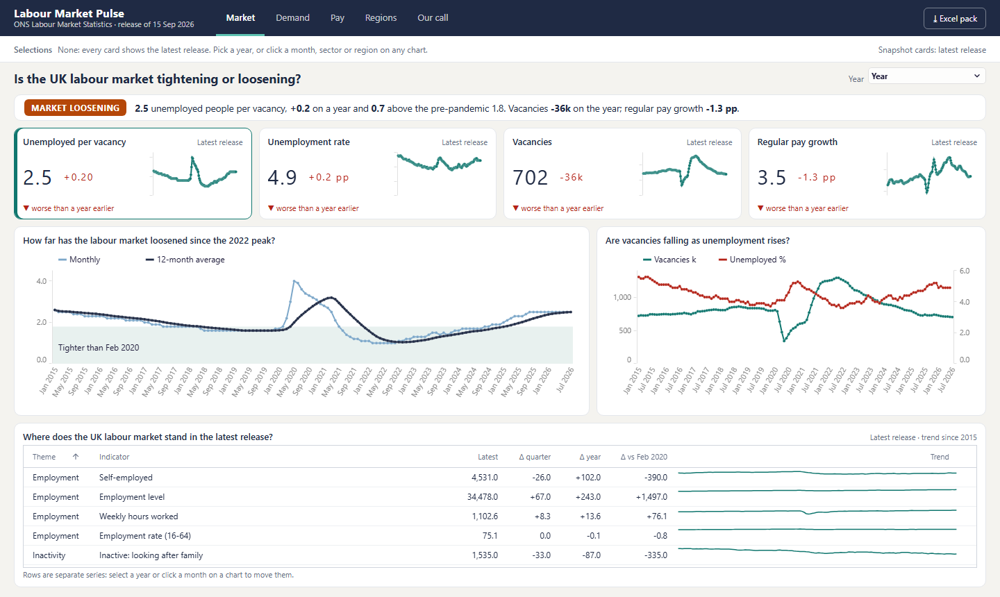
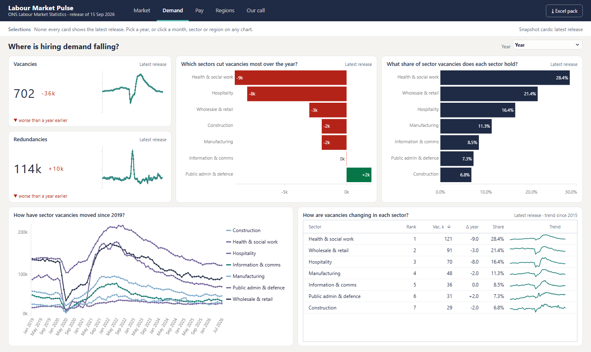
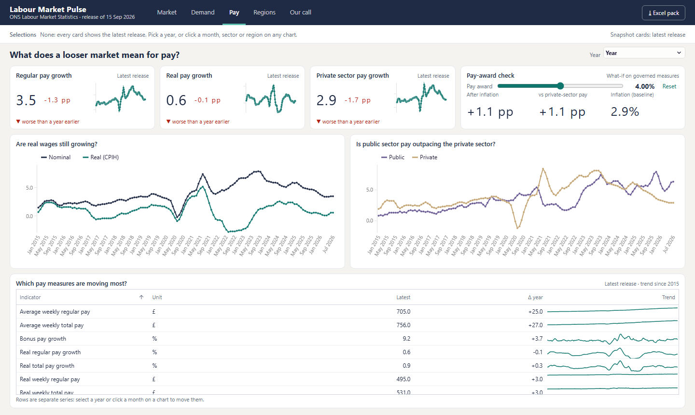
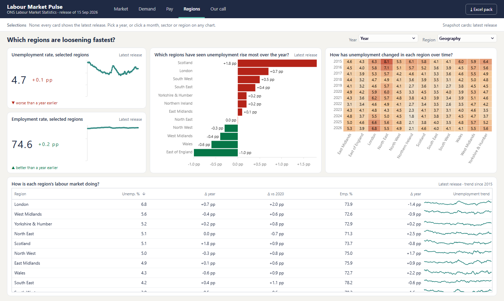
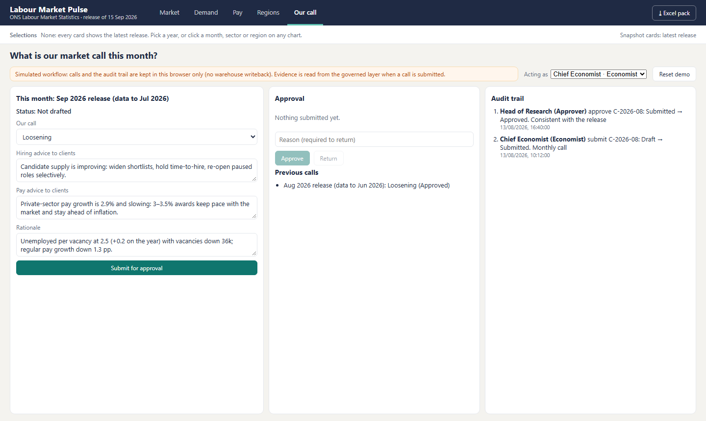

# Labour Market Pulse — the monthly ONS labour market release

The chief economist of a UK recruitment firm asks, the day after each ONS labour market release:
*is the UK labour market tightening or loosening this month, and what do we tell clients about
hiring and pay?* The app walks from the headline, to where demand is falling, to what it does to
pay, to which regions, and ends with the month's call, which the Head of Research approves. In the
screenshots (release of 15 Sep 2026) the market is **loosening**: 2.5 unemployed people per vacancy,
+0.2 on a year and 0.7 above the pre-pandemic 1.8; vacancies 702k, −36k on the year, with health
& social work (−9k) and hospitality (−8k) cutting most; regular pay growth 3.5%, −1.3 pp, private
sector 2.9%, real pay 0.6%; Scotland's unemployment rate up 1.8 pp on the year, London's highest
at 6.8%.

**This app was built by an agent from this repo, in a clean environment, as a test run**, then
brought up to standard. It shows what the [playbook](../../playbook/README.md) produces from a
semantic layer and a one-line decision, caveats included. A hand-written Astrato App on Vite and the
public `@astrato-io` packages (visualizations 0.9, app-runtime 0.8).

<p>
  
  
  
  
  
</p>

## Tabs

Above every tab: **Excel pack** in the header; a sticky selection bar with a chip per selection
(×, Clear all), a hint when empty, and the basis of the snapshot cards ("latest release" or
"average of the selected months"). Each data tab has a **Year** dropdown; Regions adds **Region**.
Chart clicks select a month, a sector or a region. Every card is titled with its question.

- **Market** — a *Market loosening* / *tightening* badge and a hero sentence; four KPIs (unemployed per vacancy, unemployment rate, vacancies, regular pay growth), each with its change on a year coloured by whether it is better or worse, and a monthly mini line; unemployed per vacancy since 2015 with a 12-month moving average and a band up to the pre-pandemic level; vacancies (left axis) against the unemployment rate (right axis); every UK headline indicator with its latest value, Δ quarter, Δ year, Δ vs Feb 2020 and a trend column.
- **Demand** — vacancies and redundancies KPIs; change in vacancies on the year by sector (signed bars, falls red); each sector's share of sector vacancies; sector vacancies since 2019; a ranked sector table with change, share and trend.
- **Pay** — regular, real and private sector pay growth KPIs; a pay-award check (slider 0–8%, default 4%) showing the award after inflation, its gap to private-sector pay growth and the inflation baseline; nominal against real pay growth; public against private sector pay growth; every pay measure with its change and trend.
- **Regions** — unemployment and employment rate across the selected regions; change in unemployment on the year by region (ranked, rises red); a region × year heat map of unemployment; every region's unemployment and employment rates with changes and an unemployment trend.
- **Our call** — Loosening / Stable / Tightening with hiring advice, pay advice and a rationale; the Chief Economist submits, the Head of Research approves or returns (a reason is required to return), nobody decides on their own call; previous calls and an audit trail; reset. The latest headline figures are attached as evidence on submit. Browser-only, and labelled so.

## Worth copying

**Snapshot cards that follow a time selection.** A "latest release" card cannot simply intersect
`Period Status = Latest` with a selected year: the result is empty. Snapshot cards are declared
with `latest: true` ([catalogue.js:34](project/src/catalogue.js#L34)) and mount with the Latest
static filter; when a Year or month is selected, `refreshLatest` swaps their static filter group
for one without it through `setStaticFilterGroup` ([app.js:266](project/src/app.js#L266), the op at
[app.js:276](project/src/app.js#L276)), and the card subtitle changes to "Average of the selected
months". Tables do the same by swapping to a selected-period variant compiled at load
([app.js:134](project/src/app.js#L134)) and mounted into the same slot ([app.js:252](project/src/app.js#L252)).
The latest-release tables keep "latest" inside their measures (`Latest Value`, `Latest Change on a
Year Earlier`), so they carry no period filter and their trend column draws the full history
([catalogue.js:59](project/src/catalogue.js#L59)).

**Two selection groups per tab, mirrored only while visible.** One app-wide state holds the
selections; each data tab has a group for charts and filters and one for KPIs, and `SCOPE` says
which fields each takes: KPIs on UK series take only time, Demand's charts also take Sector,
Regions takes Geography ([app.js:42](project/src/app.js#L42)). `mirrorInto` copies the state into
the visible tab's groups by difference ([app.js:97](project/src/app.js#L97)), on every change and
when a tab is opened ([app.js:407](project/src/app.js#L407)). Pending selections from chart clicks
are applied after 200 ms and become the app's state ([app.js:313](project/src/app.js#L313)); chips
for a field the visible tab cannot take are greyed ([app.js:294](project/src/app.js#L294)).

**What-if through a layer parameter.** `Real Value of Pay Award` and `Pay Award vs Private Sector
Pay Growth` take the layer parameter `Pay Award %`; the slider sets it on the two mounted numbers
with `setMeasureDefinedParameter` through `applyRuntimeOperations`, no remount
([app.js:368](project/src/app.js#L368), the op at [app.js:379](project/src/app.js#L379)). The baseline,
`Implied CPIH Inflation`, is a governed measure beside them.

**Every object on a stored question.** All 38 charts, tables and KPI parts stand for 34 of the
layer's 42 stored questions, named by the card's question ([catalogue.js:38](project/src/catalogue.js#L38)).
[tools/questions.mjs](project/tools/questions.mjs) turns each tile into a question definition,
including the moving average and the rank as advanced calculations ([questions.mjs:45](project/tools/questions.mjs#L45)).
Only the hero sentence, the KPI colours, the workflow evidence and the Excel pack read stored
measures through the app's own governed query ([app.js:71](project/src/app.js#L71)).

**KPI = number + coloured comparison + mini line.** The value is a native `number` with the
stored "… Change on Year" measure added as its comparison ([tiles.js:126](project/src/tiles.js#L126));
those change measures are null where there is no prior year, rather than the value itself. After
render, the app reads the change with the card's own selections and colours the comparison and its
caption by its sign and whether up is good for that measure ([app.js:233](project/src/app.js#L233)).
The mini line is its own object on its own question ([catalogue.js:35](project/src/catalogue.js#L35)).

**The direct-query shape the engine accepts.** `engine.getData` dimensions go as `{ itemKey,
label }`, the shape charts send; `{ fieldKey: '[dimension]…' }` is refused with HTTP 400
"Astrato rejected the runtime request" ([app.js:72](project/src/app.js#L72)). `contains` filters were
refused by `getData` too, so the Excel pack reads sectors through the `Sector` dimension and the
sector measures' own filter ([export.js:72](project/src/export.js#L72)); the `contains` static filter
on charts is fine ([tiles.js:31](project/src/tiles.js#L31)).

Also useful:
- every tab mounted at load through four lanes, the visible tab first and mini lines last ([app.js:219](project/src/app.js#L219)), inactive panes off-screen rather than `display: none` ([styles.css:43](project/src/styles.css#L43)) at the active width ([app.js:399](project/src/app.js#L399));
- tables with static column widths refitted to the slot after mount, on resize and on tab show, with `setColumnWidth` operations, never a remount ([app.js:198](project/src/app.js#L198), widths at [tiles.js:107](project/src/tiles.js#L107));
- the pre-pandemic band on the hero trend, its level read from a stored measure before mount ([app.js:431](project/src/app.js#L431), the band at [tiles.js:82](project/src/tiles.js#L82));
- signed bars coloured by meaning, falls in vacancies and rises in unemployment red ([tiles.js:87](project/src/tiles.js#L87));
- one pre-mount path (definition → compile → operations) shared with the compile check ([tiles.js:196](project/src/tiles.js#L196), [tools/compile-adapter.mjs](project/tools/compile-adapter.mjs)), which also replays the static-filter swap and the parameter;
- a query lane with 429 backoff, timeouts and a session cache keyed by the exact request ([throttle.js:112](project/src/throttle.js#L112));
- the maker–checker call with "Acting as" and the four-eyes rule ([workflow.js:43](project/src/workflow.js#L43), [workflow.js:62](project/src/workflow.js#L62));
- a seven-sheet Excel pack (Summary with the current call, Market, Demand, Pay, Regions, Data, Definitions) from governed queries that carry the app-wide selections explicitly, so hidden tabs follow them too; each sheet takes the selections its tab takes on screen, and its banner names those it follows and those it does not (a Region on the UK-wide Summary, say) ([export.js:37](project/src/export.js#L37)). `buildWorkbook` returns the Blob and the button downloads it; `appState.exportProbe` lets the kit smoke test build the pack with and without a Year from the landing tab and fail any sheet that did not change ([app.js:536](project/src/app.js#L536));
- `?tab=` opens on a tab ([app.js:416](project/src/app.js#L416));
- nine self-checks the smoke test runs, each through the app's real selection path ([app.js:465](project/src/app.js#L465)).

## Semantic layer

[`layers/uk-labour-market`](../../layers/uk-labour-market/) ("UK Labour Market (ONS LMS)"): 1 view,
no joins, 11 dimensions, 50 measures and 42 stored business questions.

- **View:** `Labour Market` (`LMS_FACT`): one row per ONS series per month, Jan 2015 to Jun/Jul 2026, with the series' value 3 and 12 months earlier and in Feb 2020 on the same row, and a `Period Status` of Latest or History per series.
- **Dimensions used:** Period, Year, Period Status, Sector, Geography, Indicator, Theme, Unit, Sex (static filter only). Selections go on each dimension's raw column ([app.js:88](project/src/app.js#L88)).
- **Measures used:** the headline series (Unemployed per Vacancy, Unemployment Rate, Vacancies (000s), Regular / Real Regular / Private / Public Sector Pay Growth, Redundancies (000s)) and their guarded "… Change on Year" measures; Unemployed per Vacancy Pre-Pandemic; Value, Change on Quarter, Change on a Year Earlier, Change vs Pre-Pandemic and their `Latest …` forms; Sector Vacancies (000s), Sector Vacancy Change on Year (000s), Share of Sector Vacancies and its latest form; the regional rates and changes and their latest forms; Implied CPIH Inflation, Real Value of Pay Award and Pay Award vs Private Sector Pay Growth (parameter `Pay Award %`, default 4).
- **Questions:** 34 of the 42, e.g. *How far has the labour market loosened since the 2022 peak?*, *Where does the UK labour market stand in the latest release?*, *Which sectors cut vacancies most over the year?*, *What is a pay award worth after inflation?*, *Which regions have seen unemployment rise most over the year?* Full list in [questions.md](../../layers/uk-labour-market/questions.md).
- Defined but unused by the app: eight questions (among them *Is the jobs market loosening?*, *Why are people economically inactive?*, *Is long-term sickness still rising?*), and measures such as Youth Unemployment Rate, Employment Rate, Inactivity Rate, Long-term Sick (000s), Employment Level (000s), Growth on Year % and the unguarded Change on Year.

## Rebuild from nothing

1. **Data.** Load the ONS Labour Market Statistics series into a table shaped like [`schema/ddl.sql`](../../layers/uk-labour-market/schema/ddl.sql): one row per series per month, with the value a quarter and a year earlier and in Feb 2020, and `PERIOD_STATUS = 'Latest'` on each series' latest month. The loading script is **not included in this repo**; No data is shipped: once your table is loaded, profile the layer over MCP ([playbook step 1](../../playbook/1-read-the-layer.md)) to see each dimension's values.
2. **Layer.** Recreate it from [`layer.json`](../../layers/uk-labour-market/layer.json), pointing the view at your table, and publish it. The app needs the guarded change measures, the `Latest …` measures, the `Pay Award %` parameter and the questions above; `node tools/questions.mjs > tools/questions-batch.json` regenerates the batch of app questions.
3. **App.** See Run it.

## Run it

```sh
cd project
npm install                # public npm: @astrato-io/app-runtime, @astrato-io/visualizations, vite
# set semanticLayerId in astrato.json to your copy of the layer (it ships as a zero placeholder)
astrato login
npm run compile-check      # all 43 objects and the 4 table variants compile, no session needed
astrato dev .              # open the sign-in URL it prints
node ../../../kit/verify/smoke.mjs "<that sign-in URL>" --widths 1440,1280,1024 --allow tools/smoke-allow.txt
astrato build .
```

Needs Node 24.18 or later. [docs/brief.md](project/docs/brief.md) and
[docs/data-brief.md](project/docs/data-brief.md) are the agent's own brief and data brief from the build.

## Caveats

- **A test run.** Built by an agent from this repo in a clean environment, then brought up to standard; read it as what the playbook produces.
- **One fixed release** (15 Sep 2026), not live. The latest period differs by series (Apr–Jun 2026 for survey series, Jul 2026 for pay and vacancies), so every "latest" figure uses `Period Status`, never the view's maximum date.
- **No writeback.** The call and its audit trail live in `localStorage` (`labour-market-pulse-calls-v1`, [workflow.js:9](project/src/workflow.js#L9)), and the screen says so.
- The hero's "above the pre-pandemic" figure is a subtraction in the app of two governed values ([app.js:426](project/src/app.js#L426)), and the badge is an app rule on the sign of the U/V change with a ±0.05 dead band ([app.js:422](project/src/app.js#L422)), not a stored measure.
- Headline measures average the monthly readings in context: with a Year selected a KPI shows the year's average, not its last reading (the card says so). Regional KPIs average the selected regions unweighted.
- Sector vacancies cover seven sectors (426k of 702k), not the full industry breakdown. A Geography selection applies on Regions only.
- KPIs query twice under a time selection: once for the selection, once for the static-filter swap.
- The sector trend reuses similar purples; several lines are hard to tell apart.
- The questions are written from the app's catalogue, not synced back from the stored definitions; the five owner-authored questions the app uses are restated in the catalogue and could drift. The header of `questions.mjs` names a `src/questions.js` and a `tools/sync-questions.mjs` that do not exist.
- The Excel Definitions sheet uses notes written in the app ([export.js:14](project/src/export.js#L14)), not the layer's descriptions, and omit some measures the pack uses (Redundancies, the pay "Change on Year" measures, the pre-pandemic level); the Pay sheet holds only the three pay KPIs, not the what-if. With a time selected the Data sheet lists every selected month per indicator (the screen's table averages them), capped at 10,000 rows with a note if reached. Export with a Sector selection is untested.
- The pay and regional tables scroll inside their cards at 1440.
- Inert leftovers: an unused prefetch helper in `throttle.js`, whose header still mentions a timetable and a `prefetch.js`.
- A library console error on visualizations 0.9 (TypeError reading `reduce` in the table's `pivotRowDimensionsAsColumns`) is allow-listed in [tools/smoke-allow.txt](project/tools/smoke-allow.txt); the table still renders. Its second line matches any "visualization reported an error", so it would hide other object errors too.
- Checked in staging with the kit smoke test at 1440, 1280 and 1024: PASS, 43 objects, landing-ready in about 4–5 s, 9/9 app checks (five selections across the four data tabs, each changing a KPI, a chart and a table and restored by Clear all; a Year that holds across tabs; the Excel pack with a Year selected; the what-if; the workflow, read-only); `npm run compile-check` 47/47; build passes.
- `astrato.json` carries a zero placeholder `semanticLayerId`; `layer.json`'s datasource is a placeholder too.

## Data source and licence

Contains public sector information licensed under the [Open Government Licence v3.0](https://www.nationalarchives.gov.uk/doc/open-government-licence/version/3/). Source: Office for National Statistics, UK Labour Market Statistics. See [DATA-SOURCES.md](../../DATA-SOURCES.md).
