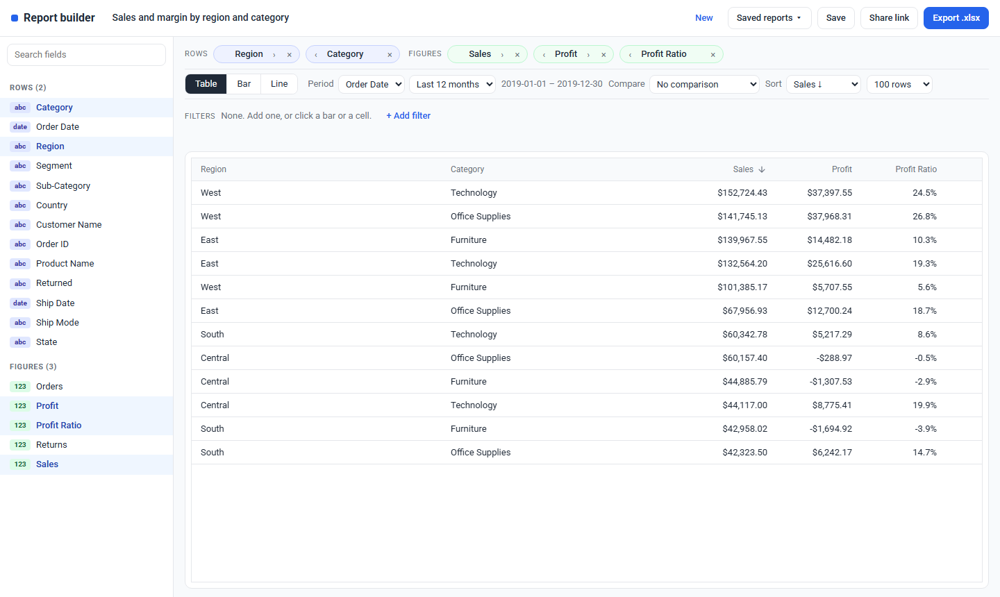
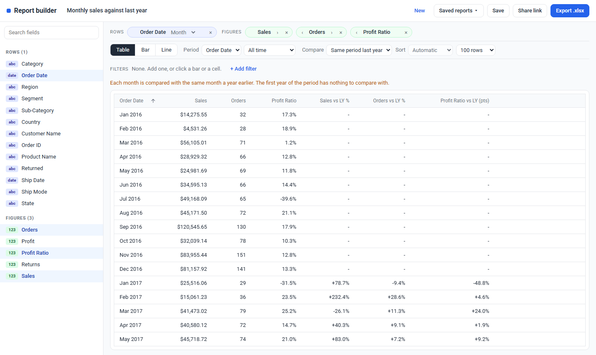
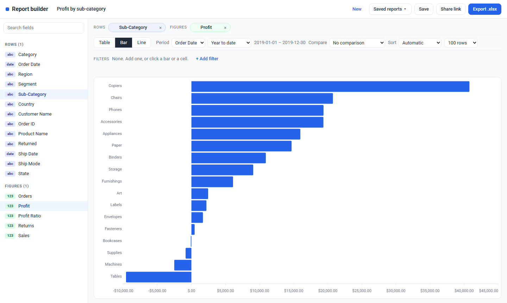
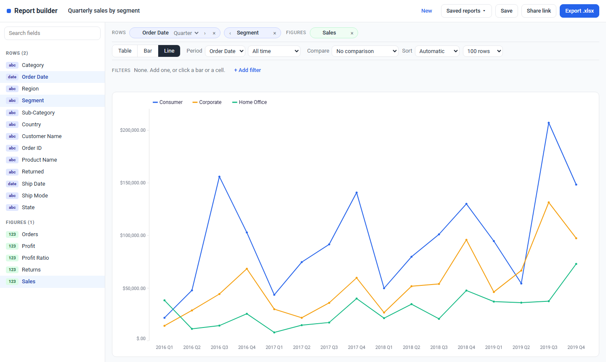

# Report builder — a flexible custom report on any semantic layer

Someone asks for *a flexible custom report*: pick the rows, the figures, the filters and the
period; compare with last period or last year; see it as a table or a chart; save it, share it,
export it. This is the examples' small, standalone answer, in 851 lines of app code. Start from it
whenever the request is a self-service report; the Custom report tab in
[people-intelligence](../people-intelligence/) is the larger, branded version it was cut from.
It runs on any semantic layer: the field catalogue is read at run time
([catalogue.js:12](project/src/catalogue.js#L12)) and nothing in the app names a field. It ships on
the public Superstore sample (one orders table, January 2016 to 30 Dec 2019). In the second
screenshot, Sales for December 2019 was $96,410.63 against $126,106.54 a year earlier: the native
table's *Sales vs LY %* reads −23.55%, checked by hand. A hand-written Astrato App on Vite and the
public `@astrato-io` packages (visualizations 0.9, app-runtime 0.8).

<p>
  
  
  
  
</p>

## The page

One screen, no page scroll. The top bar holds the report name (editable), New, Saved reports
(saved ones and four starters), Save, Share link and Export .xlsx. On the left, a searchable field
panel lists **Rows** (the layer's text, date and boolean columns) and **Figures** (its governed
measures); a click adds or removes one. Above the report: a chip bar of the chosen rows and figures,
each with ‹ › to reorder and × to remove, and a Year / Quarter / Month / Day picker on date rows;
one control row with Table / Bar / Line, the period (date field and preset), Compare (none, previous
period, same period last year), Sort and a row limit; and a filter bar of chips with + Add filter and
Clear all. A note explains what the comparison does, or why it cannot apply. The one native object
takes the rest of the page.

The four starters are the screenshots: *Sales and margin by region and category* (last 12 months,
by Sales), *Monthly sales against last year*, *Profit by sub-category* (bar, year to date) and
*Quarterly sales by segment* (line).

## Worth copying

**A catalogue read at run time.** Rows are the layer's string, date and boolean view columns, plus
any column a stored dimension points at, named and described by that dimension; figures are its
governed measures, with the layer's own format pattern and description
([catalogue.js:12](project/src/catalogue.js#L12)). A row is always the raw column key, because a chart
click and a selection both select on the column. Starter reports name fields and drop any the
layer lacks ([report.js:184](project/src/report.js#L184)); a saved or shared report drops them too
([builder.js:246](project/src/builder.js#L246)).

**State → spec → vSpec, all pure.** The report is one plain object: view, ordered rows (with a
grain on dates), ordered figures, compare, sort, row limit, period and filters. `reportSpec` turns
it into ordered columns with refs, labels and formats ([report.js:50](project/src/report.js#L50));
`definitionOf` builds the table, bar or line definition ([report.js:71](project/src/report.js#L71));
`prepareReport` compiles it and applies each finishing operation alone, so a refused one is
reported and never hides the rest ([report.js:156](project/src/report.js#L156)). Nothing needs a
session, so `npm run compile-check` runs the same path over every view, every starter and both
comparisons at two widths. Every change drops the object and mounts a new one, 300 ms after the
last edit ([builder.js:208](project/src/builder.js#L208), [builder.js:234](project/src/builder.js#L234)).

**Filters and the period are selections.** Each filter is an applied `inList` selection in one
group, `report` ([builder.js:59](project/src/builder.js#L59)); the value picker reads a field's values
with a governed query ([builder.js:183](project/src/builder.js#L183)); the chips and Clear all are the
app's own ([builder.js:175](project/src/builder.js#L175), [builder.js:73](project/src/builder.js#L73)).
The period is a `between` selection on the chosen date field
([builder.js:66](project/src/builder.js#L66)), its presets counting back from the last date in the
data, read once with a MIN / MAX query ([builder.js:43](project/src/builder.js#L43),
[builder.js:18](project/src/builder.js#L18)). The native object follows the group by itself. A click
on a bar or a cell leaves a pending selection that the app applies after 250 ms, so it becomes a
filter chip; a click on a date is dropped, because it would replace the period
([builder.js:341](project/src/builder.js#L341)).

**Period comparison without comparison measures.** The layer has no time axis and no
vs-last-year measures, so the change is the table's own inter-record calculation
([report.js:37](project/src/report.js#L37)). It needs a date row at month, quarter or year; the date
row is moved to the first column, because the window runs along the first dimension and is
partitioned by the rest ([report.js:53](project/src/report.js#L53)); the table is sorted by date
ascending and the offset is negative: −1 for the previous period, −12, −4 or −1 for the same month,
quarter or year last year ([report.js:46](project/src/report.js#L46), [report.js:61](project/src/report.js#L61)).
Each figure gets a change column: `growth`, or `diff` for a ratio (a figure whose format has a %),
labelled "vs LY %" or "vs LY (pts)" ([report.js:56](project/src/report.js#L56)), set with
`setMeasureAdvancedCalculationType` and `setMeasureAdvancedOffset`
([report.js:130](project/src/report.js#L130)). The note under the controls says what is compared, or
why nothing is ([builder.js:224](project/src/builder.js#L224)). Why ascending and negative: see
[Window calculations](../../knowledge/engine-and-queries.md#window-calculations-diff-growth-running-total-give-the-wrong-rows).

**Two columns on one measure.** A change column is a second copy of its figure, and format
operations find a column by its label, which the two share. So the copy is renamed first with
`setColumnLabel`, then formatted by that name ([report.js:134](project/src/report.js#L134)). Figures
take the layer's own format pattern in the definition ([report.js:69](project/src/report.js#L69)), and
dates a format for their grain ([report.js:68](project/src/report.js#L68)).

**Columns that fit.** Each figure column is as wide as its header or its widest value in the layer's
format, whichever is wider ([report.js:101](project/src/report.js#L101)); date columns are fixed and text
rows share the rest, never below 120 px ([report.js:107](project/src/report.js#L107)). On resize the app
refits the widths in place with `applyRuntimeOperations`, without a remount
([app.js:112](project/src/app.js#L112)).

**Save, reopen, share.** Save keeps up to 30 reports in `localStorage` under a key per layer
([builder.js:255](project/src/builder.js#L255), [builder.js:35](project/src/builder.js#L35)); Saved reports
lists them with the starters ([builder.js:262](project/src/builder.js#L262)) and reopens one, filters and
period included ([builder.js:247](project/src/builder.js#L247)). The address always carries the current
report as `#r=<base64url JSON>` ([builder.js:271](project/src/builder.js#L271),
[builder.js:275](project/src/builder.js#L275)), so a reload or bookmark keeps it, and Share link copies it.

**Excel of exactly what is shown.** `buildWorkbook()` returns the workbook as a Blob and the
Export .xlsx button downloads it ([builder.js:287](project/src/builder.js#L287)). It reads the mounted object's own
rows with `runtime.getData(tileId)`, so the workbook holds the comparison columns the table computed
and follows every filter and the period: they are applied selections in the object's one group.
Before reading, it applies a chart click still pending, waits for a period change to be applied and
flushes the 300 ms re-render, so the rows and the header describe the same report. The Report sheet's
header states the period (with its date field), the filters, the comparison and the row count, and
says when the row limit cut the rows. Each figure keeps the layer's format turned into an Excel format
([catalogue.js:36](project/src/catalogue.js#L36)); a Definitions sheet gives each column's meaning
from the layer's descriptions. The `.xlsx` writer has no dependencies
([xlsx.js:109](project/src/xlsx.js#L109)). The app registers `appState.exportProbe` with a Region =
West filter ([checks.js:36](project/src/checks.js#L36)), so the smoke test proves the Report sheet
follows it.

Also useful:
- the chart definitions: a bar is horizontal unless its first row is a date, a second row stacks it, and colours are dealt from an ordered palette rather than hashed, which collides ([report.js:86](project/src/report.js#L86), [report.js:144](project/src/report.js#L144));
- the getData wrapper for the object and the app: operator-less selections sent as `inList` (the engine refuses them with HTTP 400), 4 lanes, one retry, a session cache keyed by the exact request ([app.js:58](project/src/app.js#L58), [app.js:67](project/src/app.js#L67));
- seven smoke checks the app registers, each driving the real controls and reading the rows the object received ([checks.js:9](project/src/checks.js#L9)), and the starters registered as the smoke test's "tabs" ([app.js:146](project/src/app.js#L146)).

## Semantic layer

[`layers/superstore-sample`](../../layers/superstore-sample/) ("Superstore Sample"), shared with
[superstore-explorer](../superstore-explorer/): 1 view (`Orders`, one row per order line), no
joins, 6 dimensions, 5 measures and 8 stored business questions.

- **Rows offered:** the `Orders` text, date and boolean columns, the governed ones first under their dimension names (Category, Order Date, Region, Segment, Sub-Category in the screenshots), then the rest.
- **Figures offered:** all five measures: Orders, Profit, Profit Ratio, Returns, Sales.
- **Questions:** none is used; reports are ad hoc by design. Full list in [questions.md](../../layers/superstore-sample/questions.md).

On another layer, set `semanticLayerId` and the same app lists that layer's fields; starters whose
fields are missing are dropped, and with none left the first report is the first row by the first
figure ([builder.js:352](project/src/builder.js#L352)).

## Rebuild from nothing

1. **Data.** Load the public Superstore sample's orders into a table shaped like [`schema/ddl.sql`](../../layers/superstore-sample/schema/ddl.sql). The loading script is **not included in this repo**.
2. **Layer.** Recreate it from [`layers/superstore-sample/layer.json`](../../layers/superstore-sample/layer.json), pointing the `Orders` view at your table, and publish it. Or point the app at any layer you already have.
3. **App.** See Run it.

## Run it

```sh
cd project
npm install                # public npm: @astrato-io/app-runtime, @astrato-io/visualizations, vite
# set semanticLayerId in astrato.json to your layer (it ships as a zero placeholder)
astrato login
npm run compile-check      # 32 report objects compile against the installed library, no session needed
astrato dev .              # open the sign-in URL it prints
node ../../../kit/verify/smoke.mjs "<that sign-in URL>"
astrato build .
```

Needs Node 24.18 or later. Roboto is bundled from npm; nothing loads from a CDN.

## Caveats

- **The comparison is row to row, not calendar-based.** The layer has no time axis, so a gap in the dates shifts the offset, and the first period (or first year) of the range is blank. It shows only in the table, with a date row at month, quarter or year.
- While comparing, Sort is disabled and the table is sorted by date ascending ([builder.js:171](project/src/builder.js#L171)).
- A ratio's change is a difference in points but is formatted with a % sign; the header says "(pts)". In the second screenshot, Profit Ratio vs LY for Jan 2017 reads "-48.8%", meaning −48.8 points.
- Charts use the first two rows, and with two rows only the first figure ([report.js:57](project/src/report.js#L57)); they never show the comparison.
- The 7-column comparison starter scrolls sideways inside the table at 1024 px.
- Saved reports stay in one browser; Share link is how a report travels.
- **No stored business questions** behind the object: ad hoc by design. No KPI band, narrative or what-if: it is one report, not a dashboard. It also offers raw view columns as rows, which the [rubric's A3 note](../../playbook/rubric.md) counts as an unmatched object; the [pattern](../../patterns/report-builder.md) says to offer stored dimensions only.
- A bar with one row and several figures would stack on 0.9, so the example sends `setBarChartLayout: 'groups'` for it ([report.js:150](project/src/report.js#L150)); not yet re-checked in a browser. A Line view does not select on click on 0.9.
- The filter picker offers non-date rows only and reads the first 500 values of a field, listing 300 at a time with a search ([builder.js:183](project/src/builder.js#L183)).
- Periods count back from the last date in the data, so on this sample Year to date and Last 12 months are the same range (1 Jan – 30 Dec 2019).
- The app runs on any layer, but the smoke checks ([checks.js:30](project/src/checks.js#L30)) and `tools/compile-adapter.mjs` name Superstore fields; rewrite them for another layer. `tools/available-fields.json` is the catalogue a smoke run saved.
- Checked in staging with the kit smoke test at 1440, 1280 and 1024: PASS with no page scroll, landing in about 1.7 s, 7/7 app checks (build from the panel, Region filter and Clear all, Year to date, Bar / Line / Table, save + reopen + share link, Excel export, and the Dec 2019 comparison value above); `npm run compile-check` 32/32 and `vite build`; figures cross-checked against an MCP query.
- `astrato.json` carries a zero placeholder `semanticLayerId`; `layer.json`'s datasource is a placeholder too.

## Data source and licence

See [DATA-SOURCES.md](../../DATA-SOURCES.md) for where this example's data comes from and on what terms.
