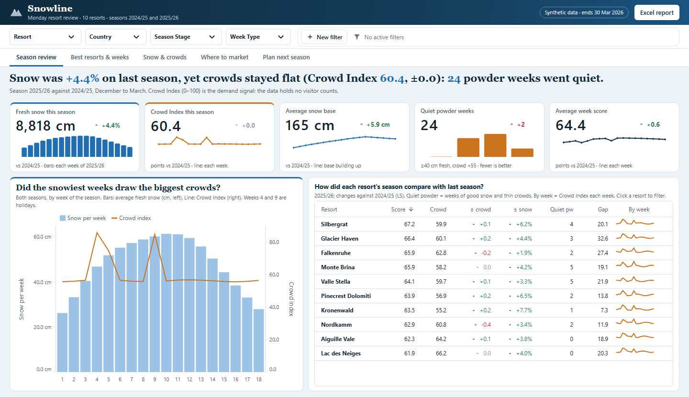
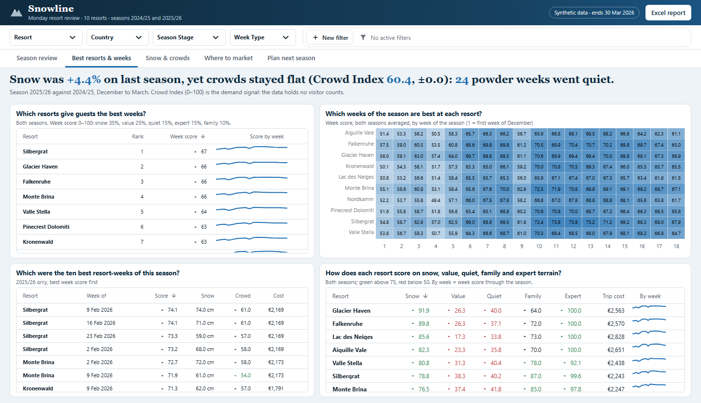
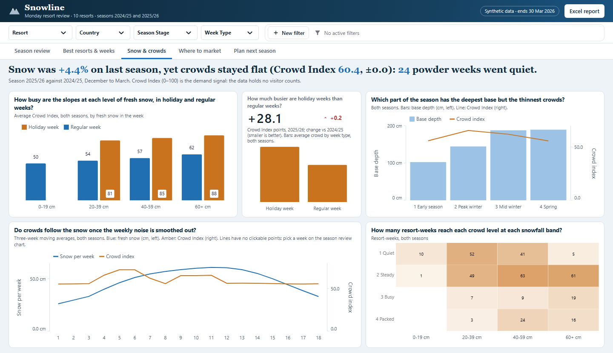
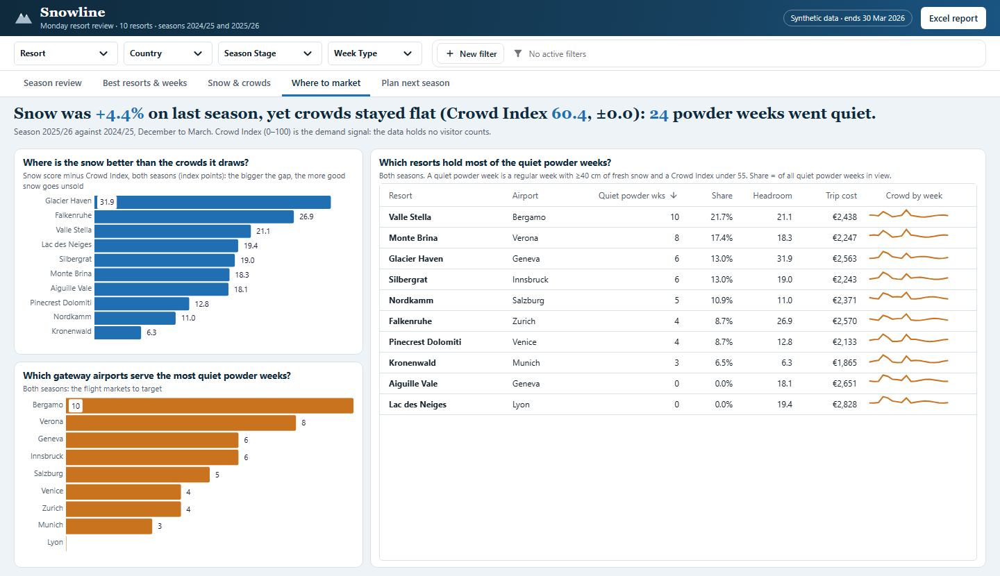
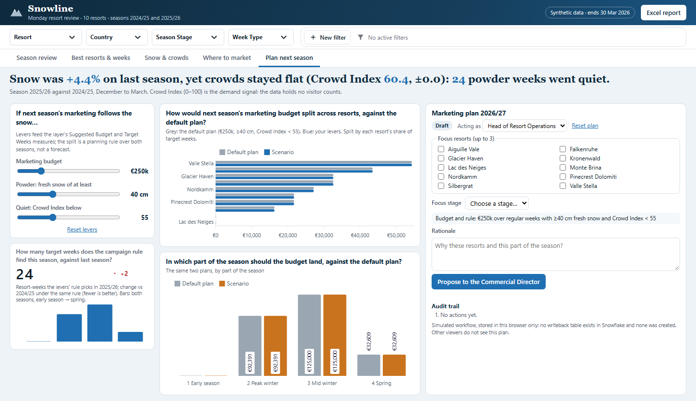

# Snowline — the Monday resort review

The head of resort operations, with the marketing lead, asks every Monday: *which resorts and
weeks do we push next season, and where does the marketing budget go?* The app walks from the
season just gone, to the best resorts and weeks, to what drives crowds, to where good snow went
unsold, to a budget plan the Commercial Director approves. In the screenshots snow was +4.4% on
last season (8,818 cm), yet the Crowd Index stayed flat at 60.4 (±0.0), and 24 powder weeks went
quiet (+2); in 2025/26 holiday weeks ran 28.1 Crowd Index points busier than regular weeks; Valle Stella
(10) and Monte Brina (8) hold the most quiet powder weeks over both seasons; and the default plan
(€250k on regular weeks with at least 40 cm of fresh snow and a Crowd Index under 55) finds 24
target weeks and puts €125,000 into mid winter.

**This example was scored by an independent judge at 47/52** ([SCORE.md](SCORE.md)) and admitted,
with no gate at 0. The judge's main gaps are listed under [Caveats](#caveats).

**A test agent built the layer as well as the app.** It was given raw Snowflake tables and no
semantic layer: it built and published the layer itself (5 views, a star of one fact and two
dimensions, 47 measures, 32 stored questions, source-schema drift 0), then the app; a staging
pass brought it up to standard, and the judge admitted it. It is the reference example for a
**layer built from raw tables**: read it beside [playbook/build-the-layer.md](../../playbook/build-the-layer.md).
All data is synthetic: ten fictional Alpine resorts over two seasons. A hand-written Astrato App
on Vite and the public `@astrato-io` packages (visualizations 0.9, app-runtime 0.9).

<p>
  
  
  
  
  
</p>

## Tabs

Above every tab: the **Synthetic data · ends 30 Mar 2026** badge and **Excel report** in the
masthead; a sticky selection bar with Resort, Country, Season Stage and Week Type dropdowns and
the library filter bar (chips, ×, Clear all); and a headline sentence that reads four stored
measures and follows the filters.

- **Season review** — five KPIs (fresh snow, Crowd Index, average snow base, quiet powder weeks, average week score), each with its change against 2024/25 coloured by whether the move is good and a native mini chart; snow and Crowd Index by week of the season for both seasons (weeks 4 and 9 are holidays); each resort's season with score, crowd, changes, quiet powder weeks, headroom and a crowd-by-week sparkline column.
- **Best resorts & weeks** — resorts ranked by week score with a score-by-week sparkline; a resort × week-of-season heat map; the ten best resort-weeks of 2025/26 with score and crowd bands; each resort's snow, value, quiet, family and expert scores.
- **Snow & crowds** — Crowd Index by fresh-snow band in holiday and regular weeks; the holiday uplift KPI with its change and a bar per week type; base depth against Crowd Index by stage; 3-week moving averages of snow and crowds; resort-weeks by crowd level and snowfall band.
- **Where to market** — demand headroom (snow score minus Crowd Index) by resort; quiet powder weeks by resort with gateway airport, share, headroom, trip cost and a crowd sparkline; quiet powder weeks by gateway airport.
- **Plan next season** — three levers (budget €50k–€1m, powder threshold 20–80 cm, quiet threshold 45–75) that feed the layer's parameterised measures; target weeks this season against 2024/25 under the same rule, with a bar per stage; the default plan (grey) beside the scenario by resort and by stage; the 2026/27 marketing plan (up to three focus resorts, a focus stage, the levers' rule, a rationale) that the Head of Resort Operations or the Marketing Lead proposes and the Commercial Director approves or returns, nobody deciding on their own proposal, with an audit trail and reset. Browser-only, and labelled so.

## Worth copying

**Levers on governed measure parameters, scenario beside a baseline.** The layer's Suggested
Budget and Target Weeks measures declare `budget`, `minSnow` and `maxCrowd`. The levers
([prepare.js:10](project/src/prepare.js#L10)) are bound before mount by `prepareTile`
([prepare.js:70](project/src/prepare.js#L70)) and, on every move, set on each mounted tile marked
`params` with `setMeasureDefinedParameter` through `applyRuntimeOperations`, no remount
([app.js:364](project/src/app.js#L364), the operations at [prepare.js:22](project/src/prepare.js#L22)).
The split charts put the stored, parameter-free Suggested Budget at Default Rule beside the
parameterised measure in one question, relabelled Default plan and Scenario
([catalogue.js:257](project/src/catalogue.js#L257)), so the baseline is governed too.

**Every object on a stored question.** All 36 charts, tables and KPI parts are tiles over 29 of
the layer's 32 stored questions, copied into [questions.js](project/src/questions.js) from the
published layer, with the question as the card title ([catalogue.js:259](project/src/catalogue.js#L259)).
Rank and moving averages travel as advanced-calculation operations
([catalogue.js:93](project/src/catalogue.js#L93)); this-season questions carry Season = 2025/26
as a static filter group on the raw Season column ([catalogue.js:289](project/src/catalogue.js#L289)).
Only the headline reads stored measures through one app-side governed query
([app.js:63](project/src/app.js#L63), [app.js:274](project/src/app.js#L274)).

**KPI = number + change row + mini chart.** The value is a native `number`; the change is a
one-row table with a three-segment indicator, red, grey inside ±flat (what the format rounds to
zero) and green, with up or down good per measure ([catalogue.js:114](project/src/catalogue.js#L114),
[catalogue.js:128](project/src/catalogue.js#L128)); the mini chart is a line or bars with axes and
legend hidden ([catalogue.js:133](project/src/catalogue.js#L133)).

**A selection group per tab, and an idle prefetch.** Filters and chips write to `main`; each tab
has its own group ([catalogue.js:17](project/src/catalogue.js#L17)) that copies `main` by
difference ([app.js:311](project/src/app.js#L311)) only while it shows. A chart click lands
pending in the tab's group and is handed to `main` after 200 ms ([app.js:331](project/src/app.js#L331)).
When the screen is idle, the app re-runs the active tab's queries with each Country, Stage and
Week type value added, so the next pick is answered from the session cache
([app.js:111](project/src/app.js#L111), [throttle.js:74](project/src/throttle.js#L74)).

Also useful:
- every tab mounted at load through four lanes, filters and the visible tab first ([app.js:435](project/src/app.js#L435)), inactive panes off-screen rather than `display: none` ([styles.css:56](project/src/styles.css#L56));
- a query lane with 429 and 502/503/504 backoff, timeouts and a session cache keyed by the exact request ([throttle.js:120](project/src/throttle.js#L120));
- table column widths from header length at the font size ([prepare.js:34](project/src/prepare.js#L34)), refitted on resize by a ResizeObserver without a remount ([app.js:376](project/src/app.js#L376));
- the maker–checker plan with "Acting as" and the four-eyes rule ([workflow.js:75](project/src/workflow.js#L75), [workflow.js:96](project/src/workflow.js#L96));
- an eight-sheet Excel report (Summary, one sheet per tab from each object's own `handle.getData`, Plan audit trail, Definitions) ([export.js:22](project/src/export.js#L22), [export.js:45](project/src/export.js#L45));
- 17 self-checks the smoke test runs, including real-click checks on five chart types ([app.js:568](project/src/app.js#L568)).

## Semantic layer

[`layers/ski-resort-operations`](../../layers/ski-resort-operations/) ("Ski Resort Operations"),
built by the test agent from the raw tables: 5 views, 2 joins (Resort Weeks many-to-one to
Resorts on Resort ID and to Season Weeks on Week ID), 13 dimensions, 47 measures and 32 stored
business questions.

- **Views:** Resort Weeks (the fact: one row per resort per season week, 360), Resorts (10), Season Weeks (36: 18 per season); Score Weights and Data Sources are reference views, not joined.
- **Dimensions used:** Resort, Country, Gateway Airport, Season Week, Week, Season Stage, Week Type, Snowfall Band, Crowd Level. Selections go on each dimension's raw column ([app.js:303](project/src/app.js#L303)); sparkline columns trend over the raw Season Week of Season Weeks.
- **Measures used:** the This Season / Last Season / Change vs Last Season families (snowfall, Crowd Index, base depth, quiet powder weeks, week score, holiday uplift, target weeks), Total Snowfall, Avg Weekly Snowfall, Avg Crowd Index, Avg Base Depth, Overall Week Score and its five component averages, Avg Trip Cost, Demand Headroom (and This Season), Quiet Powder Weeks, Share of Quiet Powder Weeks, Resort Weeks, Target Weeks and Suggested Budget (parameters `budget`, `minSnow`, `maxCrowd`), Suggested Budget at Default Rule.
- **Questions:** 29 of the 32, e.g. *Did the crowds grow with the snow?*, *Which resorts give guests the best weeks?*, *How much busier are holiday weeks than regular weeks?*, *Which resorts hold most of the quiet powder weeks?*, *How would next season's marketing budget split across resorts, against the default plan?* Full list in [questions.md](../../layers/ski-resort-operations/questions.md).
- **Modelling choice:** the season comparison names the seasons (Season = 2025/26 against 2024/25) rather than using the Season Axis: with a latest period end the axis dropped the last week of 2024/25, and the engine refused period-comparison measures when a query filtered a Season Weeks field such as stage or week type ([data-brief.md](project/docs/data-brief.md)). Roll the season names forward when new data lands.
- Defined but unused by the app: the Season Axis, Month and Season Phase dimensions; trip cost and lift pass, lodging, open terrain, bluebird days, peak and lowest crowd, first season week and headroom-change measures.

## Rebuild from nothing

1. **Data.** Load tables shaped like [`schema/ddl.sql`](../../layers/ski-resort-operations/schema/ddl.sql). The generator is **not included in this repo**; No data is shipped either: once your tables are loaded, profile the layer over MCP ([playbook step 1](../../playbook/1-read-the-layer.md)) to see each dimension's values.
2. **Layer.** Either recreate it from [`layer.json`](../../layers/ski-resort-operations/layer.json), pointing the five views at your tables, or do what the test agent did and build it from the raw tables with [playbook/build-the-layer.md](../../playbook/build-the-layer.md). Publish it. The app needs the joins, the parameterised measures and the questions above.
3. **App.** See Run it.

## Run it

```sh
cd project
npm install                # public npm: @astrato-io/app-runtime, @astrato-io/visualizations, vite
# set semanticLayerId in astrato.json to your copy of the layer (it ships as a zero placeholder)
astrato login
npm run compile-check      # all 40 objects compile against the installed library, no session needed
astrato dev .              # open the sign-in URL it prints
node ../../../kit/verify/smoke.mjs "<that sign-in URL>" --widths 1440,1280
node ../../../kit/verify/smoke.mjs "<that sign-in URL>" --widths 1024 --scroll-ok   # 1024 stacks and scrolls
astrato build .
```

The 1024 run needs `--scroll-ok`: a planner should not scroll, so without it the smoke fails there
(see Caveats). [docs/brief.md](project/docs/brief.md) and [docs/data-brief.md](project/docs/data-brief.md)
are the agent's own brief and data brief from the build; [SCORE.md](SCORE.md) is the judge's scorecard.

## Caveats

The judge's main gaps first ([SCORE.md](SCORE.md), 47/52):

- **Dropdown filters need Apply; chart clicks apply at once.** A dropdown pick makes a pending chip with Cancel / Apply, and nothing changes until Apply. The app's selection checks set applied selections through the API ([app.js:487](project/src/app.js#L487)), so they never meet this step.
- **The plan's resort-split chart labels only half the resorts** (5 of 10) at 1440 and 1280.
- **Best-tab tables cut a row at 1440, and headers ellipsise at 1280.** The three tables show a partial row, so ten rows need a scroll inside the card; at 1280 the By week and Headroom headers ellipsise.
- **Filter chips show raw field names** (Season_Stage, Resort Name, Snowfall_Band), because selections are written on the raw columns ([app.js:303](project/src/app.js#L303)); filter controls truncate their value while a selection is held.
- **"Scenario" differs in colour between the two split charts:** blue by resort, amber (the crowd colour) by stage ([catalogue.js:257](project/src/catalogue.js#L257), [catalogue.js:258](project/src/catalogue.js#L258)).
- **The landing tab reuses the league-table skeleton** of [league-table-planner](../league-table-planner/): masthead with Excel button, dropdowns and filter bar, tabs, headline sentence, KPI row, chart left and table right.
- **The plan workflow is browser-only**, because the brief forbade creating warehouse tables: plan, decisions and audit trail live in `localStorage` (`snowline-plan-2026-27-v1`, [workflow.js:20](project/src/workflow.js#L20)), and the screen says so.
- **Cold first load took about 59 s** to landing-ready and failed the kit smoke's 15 s landing budget; warm loads took 6–7 s.
- **At 1024 the layout stacks and the page scrolls vertically.**

Also:

- **Synthetic data.** Ten fictional resorts, 18 weeks in each of two seasons, ending 30 Mar 2026; not live. No visits, revenue or marketing spend: the Crowd Index stands in for visits, and the budget split is a planning rule, not a forecast.
- Objects re-express their stored questions in `questions.js` rather than run them by id (`runQuestion` needs a published App); three stored questions are unused (`targets`, `split`, `splitStage`).
- The 3-week moving-average chart has no clickable points; its card says so. Top 10 is a sort plus a 10-row limit, since tables take no topN on 0.9 ([catalogue.js:217](project/src/catalogue.js#L217)).
- Excel report: change values are raw decimals, and the Definitions sheet says the comparison uses the Season Axis over 1 Dec 2025 – 5 Apr 2026 ([export.js:68](project/src/export.js#L68)); the measures filter Season explicitly and the data ends 30 Mar 2026.
- The project's own [README](project/README.md) and docs predate the final layer revision in places (the data brief counts 43 measures and 28 questions); `layer.json` is the reference.
- Checked by the judge: all 40 objects rendered with 0 console errors and 0 failed requests through the kit smoke (17 app checks, all tabs, 1440, 1280 and 1024) and two runs with real mouse input; the KPIs reconciled with MCP queries unfiltered and with Country = Italy. **Not published**, so no live smoke.
- `astrato.json` carries a zero placeholder `semanticLayerId`; `layer.json`'s datasource is a placeholder too.
