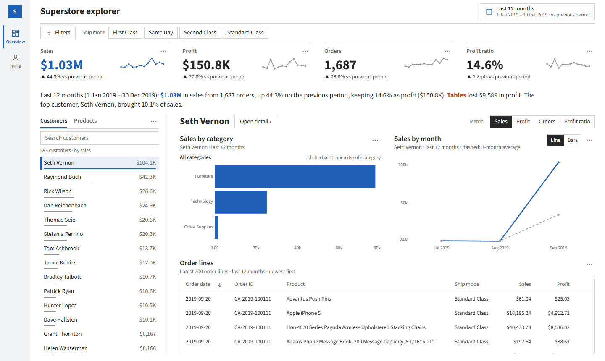
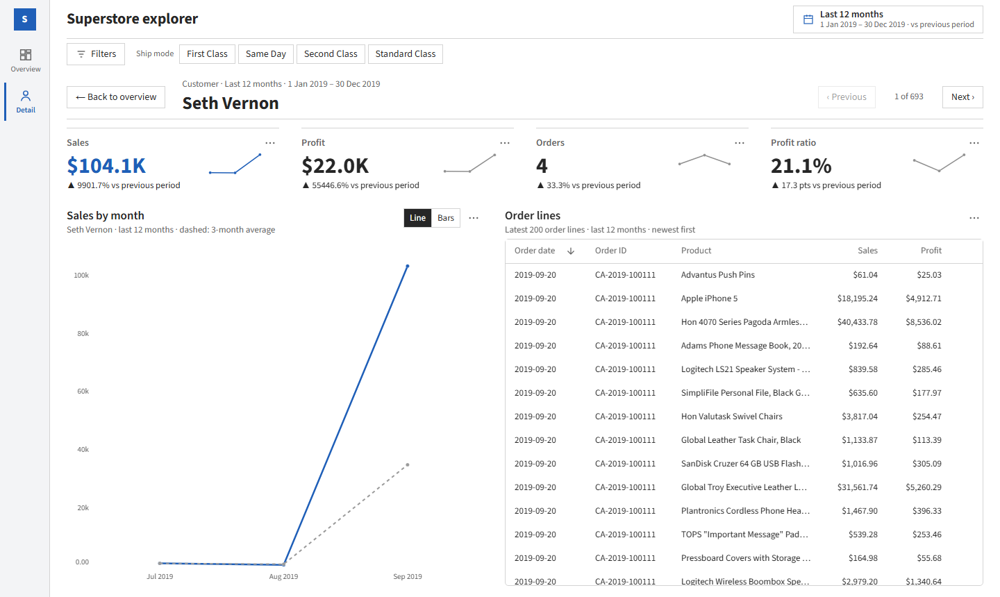

# Superstore explorer — the public Superstore sample

A sales or category manager asks: *who and what drives sales and profit in the period I choose,
and how does one customer or product compare with its previous period?* This is the
plain, minimal explorer, on the public Superstore sample (one orders table, to 30 Dec 2019). Start
from it when you want a clean explore app: a period picker, filters, a master list, a drill-down
and a drill-through page, no brand, no workflow. For a branded command centre, start from another
example. In the screenshots (last 12 months, 1 Jan – 30 Dec 2019, against the previous period),
the store sold $1.03M from 1,687 orders, up 44.3%, keeping 14.6% as profit ($150.8K); Tables lost
$9,589; and the top of 693 customers, Seth Vernon, brought 10.1% of sales. It is a hand-written
Astrato App on Vite and the public `@astrato-io` packages (visualizations 0.9, app-runtime 0.8).

<p>
  
  
</p>

## Pages

A rail on the left switches pages. Above both: the period button (Month, Quarter or Year to date,
Last 12 months, All time or a custom range; compared with the previous period, the same period
last year or nothing), a Filters drawer (Region, Segment, Category), ship-mode quick buttons, and
chips for whatever is applied, with Clear all.

- **Overview** — four KPIs (sales, profit, orders, profit ratio), each with its change against the comparison period and a native mini chart by month; a one-line narrative computed from the data; a searchable list of customers or products with a value bar per row; for the picked one, a drill-down bar (Category › Sub-Category › Product, with breadcrumbs), a trend by month that switches between a line with a dashed 3-month moving average and bars, and its order lines in a native table. A metric switch sets what the list, drill bar and trend show.
- **Detail** — drill-through to the picked customer or product: its four KPIs against its own comparison period, its trend and its order lines, with Previous / Next through the list and Back to overview.

Every object has a menu (and a right-click menu) with Show as table, Export data as CSV and Export data as Excel.

## Worth copying

**Every control is a selection in one group.** The period is a `between` selection on Order Date
([app.js:241](project/src/app.js#L241)); the drawer filters, ship-mode buttons, drill path and
picked item are `inList` selections, all written as applied into the same group
([app.js:236](project/src/app.js#L236)). The native objects follow them by themselves; the app's
own queries turn the same applied selections into filters, swapping in another date range when
asked ([app.js:248](project/src/app.js#L248)). Pending selections from a chart click are applied
after 250 ms, and a click on the trend, which would replace the period with one date, is dropped
([app.js:842](project/src/app.js#L842)). The chips and Clear all are the app's own; Clear all keeps
the period and the pick ([app.js:404](project/src/app.js#L404)).

**Period comparison without comparison measures.** Presets count back from the last order date
([app.js:74](project/src/app.js#L74)), and the comparison range is the same span one period or one
year earlier ([app.js:222](project/src/app.js#L222)). Each KPI card runs the layer's Sales, Profit,
Orders and Profit Ratio calculations twice with the same filters, once per range, and shows the
change as a percentage, or in points for the ratio ([app.js:605](project/src/app.js#L605)).

**A mirror group for "all items".** On the overview the drill bar, trend and order lines follow the
picked customer, but the KPIs describe all of them. The KPI queries leave the item fields out, and
the native mini charts sit in a second group that copies every selection except the pick
([app.js:596](project/src/app.js#L596), mounted at [app.js:594](project/src/app.js#L594)). On the
detail page the same cards read the main group, pick included.

**The operator fix.** A selection written without an operator reaches the engine as a filter
without one, which it refuses with HTTP 400 "Astrato rejected the runtime request". The getData
wrapper sends such a filter as `inList` ([app.js:142](project/src/app.js#L142)). The same wrapper
serves the charts and the app: 4 lanes, one retry and a session cache keyed by the exact request
([app.js:147](project/src/app.js#L147)), so clearing a filter or returning to a page costs no round trip.

**Native moving average and fitted tables.** The trend's dashed line is a second copy of the measure
with a native `movingCalculation` (AVG over the current and two previous rows), relabelled
"…, 3-month average" ([charts.js:172](project/src/charts.js#L172)). The order-lines table gives each
column a pixel width and the item column the rest of the slot, dropping Ship mode and then Order ID
when the slot is narrow ([charts.js:227](project/src/charts.js#L227)); on resize the app refits the
columns with `updateInstance`, without a remount ([app.js:726](project/src/app.js#L726)).

**Four visualizations 0.9 fixes** in [charts.js](project/src/charts.js): `setBarChartLayout 'stacked'`
is refused for one dimension and one measure, so the bars set no layout ([charts.js:125](project/src/charts.js#L125));
`updateMeasure` takes `customLabel` as `{ enabled, value }` ([charts.js:171](project/src/charts.js#L171));
`setAnimationEnabled` takes `{ enabled }` ([charts.js:216](project/src/charts.js#L216)); and Order Date
needs `setColumnFormatType` `yyyymmdd`, addressed by column name, or it prints epoch numbers
([charts.js:276](project/src/charts.js#L276)). Operations are applied one at a time and a refused
one is reported, never thrown ([charts.js:66](project/src/charts.js#L66)).

Also useful:
- the master list: one query of the metric by customer or product, filtered like the page but not by the pick, rendered as buttons with value bars and searched in the browser ([app.js:637](project/src/app.js#L637), [app.js:661](project/src/app.js#L661)). It is the A2 exception: navigation, not a data visual;
- the narrative: the period's sales, orders, change and profit ratio from the KPI answers, the worst sub-category by profit, and the top item's share of sales ([app.js:743](project/src/app.js#L743));
- drill-through with Previous / Next through the list as filtered and searched ([app.js:765](project/src/app.js#L765), [app.js:696](project/src/app.js#L696));
- an object menu on every object whose Show as table, CSV and Excel re-run that object's query ([app.js:980](project/src/app.js#L980)), with a dependency-free CSV and single-sheet `.xlsx` writer ([exports.js:22](project/src/exports.js#L22), [exports.js:96](project/src/exports.js#L96));
- a start-up check that every field the page needs exists in the layer, by key ([app.js:101](project/src/app.js#L101));
- five smoke checks the app registers: a Region filter from the drawer moves the KPI, drill bar and order lines and Clear all restores them; a Category drill click does the same and the breadcrumb restores it; Quarter to date reaches the trend's query; Next / Previous on the detail page; and the Excel export of the order lines ([app.js:1035](project/src/app.js#L1035)).

## Semantic layer

[`layers/superstore-sample`](../../layers/superstore-sample/) ("Superstore Sample") has 1 view,
no joins, 6 dimensions, 5 measures and 8 stored business questions.

- **View:** `Orders` (table `orders`), one row per order line.
- **Measures used:** Sales, Profit, Orders (distinct Order ID), Profit Ratio (sum of profit ÷ sum of sales).
- **Raw fields:** every dimension is a raw `Orders` column: `Order Date`, `Category`, `Sub-Category`, `Product Name`, `Customer Name`, `Ship Mode`, `Region`, `Segment`, `Order ID`. The first and last order dates are a MIN / MAX of `Order Date` ([app.js:187](project/src/app.js#L187)).
- **Questions:** none is used. The 8 stored questions (by discount, order date, segment, ship mode, category and sub-category, state, sub-category, top customers) do not match the objects' shapes. Full list in [questions.md](../../layers/superstore-sample/questions.md).
- Defined but unused by the app: the Returns measure, all 6 governed dimensions (including the `Category > Sub-Category > Product` hierarchy), and the columns `State`, `Country`, `Discount`, `Quantity`, `Returned`, `Ship Date`.

## Rebuild from nothing

1. **Data.** Load the public Superstore sample's orders into a table shaped like [`schema/ddl.sql`](../../layers/superstore-sample/schema/ddl.sql). The loading script is **not included in this repo**; No data is shipped: once your table is loaded, profile the layer over MCP ([playbook step 1](../../playbook/1-read-the-layer.md)) to see each dimension's values.
2. **Layer.** Recreate it from [`layers/superstore-sample/layer.json`](../../layers/superstore-sample/layer.json), pointing the `Orders` view at your database, schema and table, and publish it.
3. **App.** See Run it.

## Run it

```sh
cd project
npm install                # public npm: @astrato-io/app-runtime, @astrato-io/visualizations, vite
# set semanticLayerId in astrato.json to your copy of the layer (it ships as a zero placeholder)
astrato login
npm run compile-check      # every object compiles against the installed library, no session needed
astrato dev .              # open the sign-in URL it prints
node ../../../kit/verify/smoke.mjs "<that sign-in URL>"
astrato build .
```

Needs Node 24.18 or later. Fonts are bundled from npm; nothing loads from a CDN.

## Caveats

- **No stored business questions.** Every object reads the layer's calculations over raw columns; the governed dimensions and the hierarchy go unused, and the drill is the app's own. The playbook asks for stored questions.
- KPI values are text from governed queries, not native number objects; their mini charts are native.
- No period comparison on the drill bar or the trend: the layer has no time axis or comparison measures. The trend's moving average skips months with no orders, because it averages rows, not calendar months.
- The master list is an HTML list with value bars (the A2 exception, as navigation). It renders the first 300 rows of a query limited to 2,500 ([app.js:642](project/src/app.js#L642), [app.js:672](project/src/app.js#L672)); the search reaches the rest. The Show as table dialog draws an HTML table too ([app.js:958](project/src/app.js#L958)).
- Detail KPI changes run to figures like "9901.7%" when the item's previous period was tiny (see the detail screenshot).
- Money axes label zero as "0.00"; product names are cut to an ellipsis in narrow slots.
- When a filter change drops the picked customer from the list, the top one is picked instead and the original is not restored ([app.js:648](project/src/app.js#L648)).
- With the Customers list open, a product bar click at the drill's third level filters the drill bar, trend and order lines, but not the KPIs, mini charts, list or narrative, which leave both item fields out ([app.js:814](project/src/app.js#L814)). A click on the trend does nothing ([app.js:844](project/src/app.js#L844)).
- Pages are not preloaded: switching page releases every object and mounts the other page's ([app.js:884](project/src/app.js#L884)).
- Excel is one unformatted sheet per object. There is no multi-sheet management report, no what-if and no workflow: it is an explorer. The order-lines export stops at 5,000 rows ([app.js:932](project/src/app.js#L932)).
- Inert leftovers: [theme.js](project/src/theme.js) reads a saved dark-mode choice, but `styles.css` defines no dark theme; a smoke check calls the quarter-to-date start `ytdStart` ([app.js:1074](project/src/app.js#L1074)).
- Checked in staging with the kit smoke test at 1440, 1280 and 1024: PASS with no page scroll, landing in about 3 s, 5/5 app checks; `npm run compile-check` 30/30 and `vite build`.
- `tools/available-fields.json` is the field catalogue a smoke run saved; the compile check falls back to `layer.json` without it.
- `astrato.json` carries a zero placeholder `semanticLayerId`; `layer.json`'s datasource is a placeholder too.

## Data source and licence

See [DATA-SOURCES.md](../../DATA-SOURCES.md) for where this example's data comes from and on what terms.
