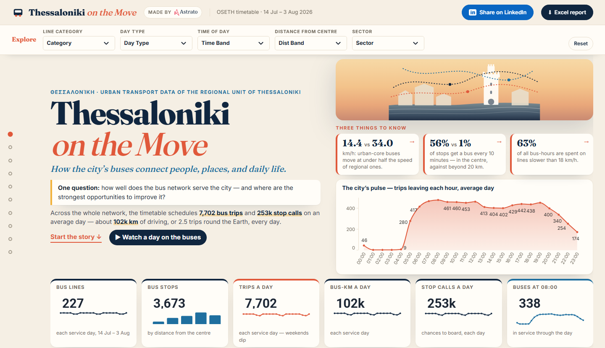
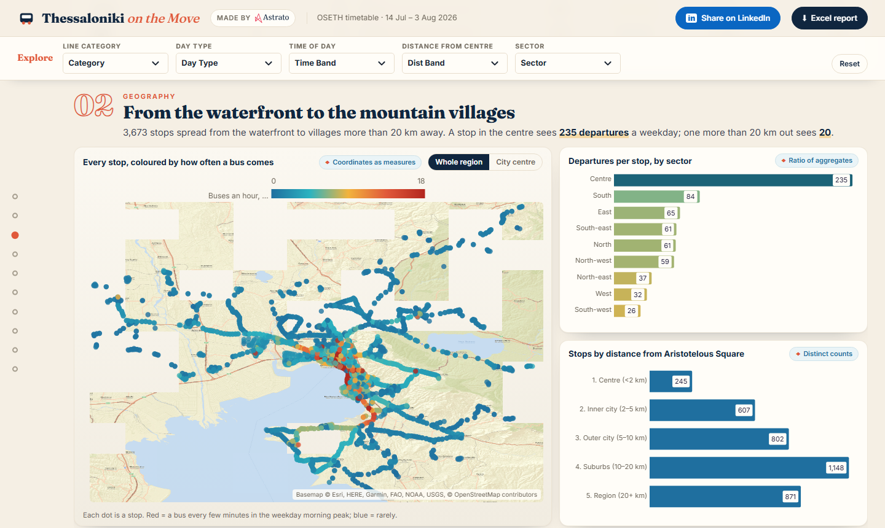
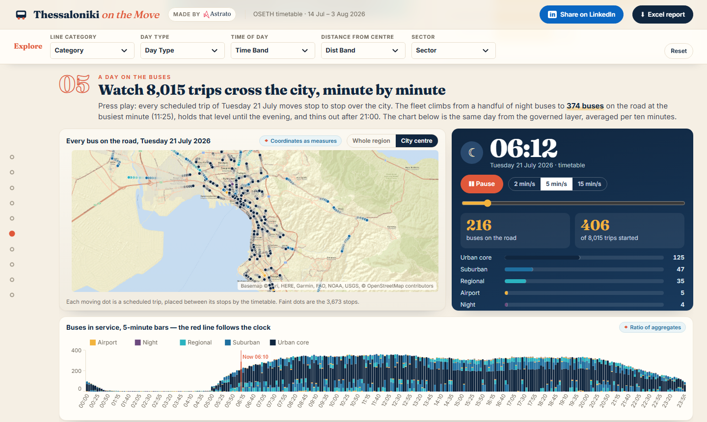
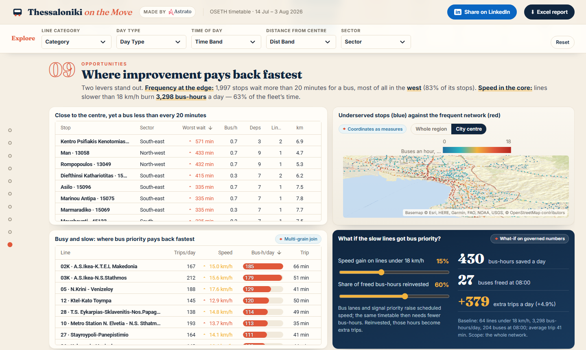

# Thessaloniki on the Move — the Thessaloniki bus network

A scrolling data story for city and transport planners and curious residents. It asks: *how well
does the bus network serve the city, and where does improvement pay back fastest: more frequency
at the edge, or bus priority in the core?* Unlike the other examples, the data is real and public:
the transport authority's (OSETH) GTFS timetable for 14 Jul – 3 Aug 2026, loaded into the warehouse
and modelled in a semantic layer. It is **scheduled service, not ridership**. In the screenshots
(whole network), the timetable runs 7,702 trips, 102k bus-km and 253k stop calls on an average
day across 227 lines and 3,673 stops. Urban-core buses are scheduled at 14.4 km/h against 34.0 km/h
on regional lines; 56% of stops in the centre get a bus every 10 minutes at the morning peak
against 1% beyond 20 km; and lines slower than 18 km/h use 63% of all bus-hours (3,298 a day).
It is a hand-written Astrato App on Vite and the public `@astrato-io` packages (visualizations 0.9,
app-runtime 0.8): a hero, nine chapters on one page, one filter bar.

<p>
  
  
  
  
</p>

## Chapters

A chapter rail on the left jumps between them; on desktop the wheel and arrow keys move one
chapter per gesture. Every chapter opens with a sentence composed from governed queries that
follows the filter bar (line category, day type, time of day, distance from centre, sector).

- **The network** (hero) — six KPIs (lines, stops, trips, bus-km, stop calls, buses at 08:00), each with a mini chart; "Three things to know" (each links to its chapter); the city's pulse, trips leaving each hour (area line); "Excel report" and "Share" in the top bar.
- **01 Scale** — trips a day by line category (bar), share of bus-km (donut), and a category table with a progress-bar share column and speed coloured by band.
- **02 Geography** — every stop on a street basemap, coloured from blue (rare) to red (a bus every few minutes), with a whole-region / city-centre switch; departures per stop by sector; stops by distance from Aristotelous Square.
- **03 Access** — four KPIs (frequent stops, underserved stops, longest wait, no Sunday bus); frequent vs underserved by distance band (grouped bar); stops by peak service level (donut); longest daytime wait by distance.
- **04 Rhythm** — trips each hour by day type (line), every service day × hour (heatmap), trips by day of week, share of trips by time band.
- **05 Live day** — every scheduled trip of Tuesday 21 July moving stop to stop over the map, with play/pause, three speeds, a scrubber, buses on the road by category and the five busiest lines right now; under it, the governed fleet chart (stacked by category) with a red playhead that follows the clock.
- **06 Boarding** — the 25 busiest stops (table), stops by number of lines calling, share of weekday departures by sector. Scheduled departures stand in for demand.
- **07 Operations** — scheduled speed by category, every line as a dot (weekday trips against speed, with average and median lines on both axes; click a dot to open the line), buses at 08:00 for the top 15 lines, bus-hours by time band.
- **08 Routes** — a line dropdown (or a click on any line in the story) drives the line's profile table, its stops on the map with its path drawn in colour, and trips each hour on a weekday, Saturday and Sunday; below, every line compared in one table.
- **09 Opportunities** — stops within 10 km of the centre that wait more than 20 minutes for a bus; underserved against frequent stops on the map; busy slow lines ranked by bus-hours; and a what-if: speed gain on lines under 18 km/h and the share of freed bus-hours reinvested give bus-hours saved, buses freed at 08:00 and extra trips a day.

## Worth copying

**Instant selections.** Every engine request goes through four lanes with a session cache keyed by
the exact request ([throttle.js:108](project/src/throttle.js#L108)). When the app is idle it
re-runs the query shapes of the chapter on screen with each filter value added, two at a time,
yielding whenever a real query starts ([throttle.js:66](project/src/throttle.js#L66)), so the
next click is usually answered from the cache. The values come once from the layer, and
prefetch does not start until every object has mounted
([app.js:748](project/src/app.js#L748), [app.js:1145](project/src/app.js#L1145)): started during
boot, it held two lanes and slowed the last mounts. 429s back off up to six times; 502, 503 and
504 are retried at most twice ([throttle.js:117](project/src/throttle.js#L117)).

**One selection group per chapter.** Every object except the filter bar and the route explorer
is moved into its chapter's own group ([dashboard.js:457](project/src/dashboard.js#L457)). A
filter-bar change marks every chapter dirty, mirrors it into the chapter on screen at once and
into the chapters either side 1.8 s later; the rest catch up when scrolled to
([app.js:775](project/src/app.js#L775)). A click inside a chapter is moved to the filter bar as a
pending selection, which the app applies after 300 ms ([app.js:787](project/src/app.js#L787)).
The chips and Reset are the app's own; Reset removes the main group's selections outside the
mirroring flag, so chips, chapters and narratives all refresh ([app.js:261](project/src/app.js#L261)).

**A map from a scatter.** A stop map is a scatter whose measures are `Stop Lon` and `Stop Lat`,
coloured by the raw `AM Peak Buses Per Hour` field ([dashboard.js:130](project/src/dashboard.js#L130)).
Its axes are pinned to a lon/lat window ([dashboard.js:488](project/src/dashboard.js#L488)) widened
to the plot's own aspect, so a kilometre across equals a kilometre down ([app.js:493](project/src/app.js#L493)).
Raster street tiles sit behind the chart's plot canvas, each placed by its own lon/lat bounds
([basemap.js:37](project/src/basemap.js#L37)). On visualizations 0.9 the gradient's 0–18 limits
take effect only after `setColoringGradientAuto: false` ([theme.js:298](project/src/theme.js#L298)).

**A day on the buses.** The animation reads `public/sim-day.json`, the timetable of one weekday
compacted (3,673 stops, 216 lines, stop-time patterns, 8,015 trips). That file is a trips extract,
so it is **not shipped**: without it the live-day panel says it needs a trips extract and the
rest of the app, the governed fleet chart included, works as normal. Its shape is documented at
the top of [sim.js](project/src/sim.js). Each bus is interpolated between the
scheduled times of consecutive stops ([sim.js:33](project/src/sim.js#L33)) and drawn on a canvas
laid exactly over the stop map's plot canvas ([sim.js:56](project/src/sim.js#L56)). The governed
fleet chart below is mounted three times (2-, 5- and 15-minute bars, one shown per speed,
[dashboard.js:239](project/src/dashboard.js#L239)); the clock moves a native reference line on its
time axis, at most four times a second ([app.js:958](project/src/app.js#L958)).

**Route explorer in its own group.** A click on a line anywhere in the story opens it in the route
explorer instead of filtering ([app.js:718](project/src/app.js#L718)). The pick is written on the
dropdown's own `Line Label` field, so the dropdown's other labels stay selectable
([app.js:708](project/src/app.js#L708)); several lines can be compared, each path drawn in its own
colour from the day file, and the map refits to their stops ([app.js:826](project/src/app.js#L826)).

**Narratives and a what-if on governed numbers.** One batch of governed queries, filtered like the
screen, feeds every chapter's sentence, the three findings and the scatter's average and median
lines ([app.js:576](project/src/app.js#L576), [app.js:656](project/src/app.js#L656)). The bus-priority
what-if takes the lines under 18 km/h from the same rows: a speed gain *g* saves bus-hours × g/(1+g),
and the reinvested share becomes extra trips at the average trip length ([app.js:677](project/src/app.js#L677)).

Also useful:
- KPIs are one-row tables over the one-value `City` column, so they narrow with selections ([dashboard.js:99](project/src/dashboard.js#L99)); their mini charts are lines by service day, a bar by distance band and the fleet by hour ([dashboard.js:162](project/src/dashboard.js#L162));
- all 54 objects mount at load through four lanes, hero numbers first, and the splash closes when the six hero values are in ([app.js:1139](project/src/app.js#L1139));
- table columns are pixel shares of the slot, refitted on resize without a remount ([app.js:539](project/src/app.js#L539));
- a seven-sheet management report (summary with bullets, lines, daily rhythm, access, opportunities, every stop, definitions) from governed queries that pass the filter bar's applied selections explicitly, so every sheet follows them whichever chapter is on screen; a pick still in its 300 ms debounce is applied first, and each sheet's subtitle lists every filter value in full ([report.js:32](project/src/report.js#L32), [app.js:1104](project/src/app.js#L1104)). `buildWorkbook()` returns the Blob and the button downloads it; the app registers `appState.exportProbe` with a line-category filter, so the smoke test proves every sheet but Definitions moves with it ([app.js:1236](project/src/app.js#L1236)). Written by a dependency-free OOXML writer ([xlsx.js:202](project/src/xlsx.js#L202));
- a 1200×627 share card drawn on a canvas from the governed figures, with an editable suggested post, a download and the system share sheet where the browser has one ([share.js:41](project/src/share.js#L41), [app.js:1054](project/src/app.js#L1054));
- thirteen smoke checks the app registers: on each of the ten sections a line-category filter moves a figure and an object and Reset restores them, the route explorer changes line and back, the what-if moves with its slider, and the Excel report downloads ([app.js:1175](project/src/app.js#L1175)).

## Semantic layer

[`layers/thessaloniki-transit`](../../layers/thessaloniki-transit/) ("Thessaloniki on the Move")
has 7 views, 7 joins, 26 dimensions, 63 measures and no stored business questions.

- **Views:** `Service` (`TH_SERVICE`, scheduled trips, bus-km, bus-hours and stop calls by service date, line and hour), `Lines` (`TH_LINES`, one row per line with its reference-weekday profile), `Stops` (`TH_STOPS`, one row per stop with distance band, sector and service level), `Line Stops` (`TH_LINE_STOPS`), `Fleet` (`TH_FLEET_MINUTE`, buses active by minute and category on the reference weekday), and two Custom SQL views, `Categories` (the distinct line categories) and `Hours` (24 hours with their time band).
- **Joins**, all many-to-one: `Service` and `Line Stops` to `Lines` on `Line`; `Line Stops` to `Stops` on `Stop Id`; `Lines` and `Fleet` to `Categories` on category; `Service` and `Fleet` to `Hours` on the hour. The conformed `Categories` and `Hours` views let one filter reach the fleet and the service facts.
- **Measures used:** Trips, Trips per Day, Weekday / Saturday / Sunday Trips per Day, Sunday Retention, Share of Trips, Peak Share, Vehicle Km, Vehicle Km per Day, Share of Vehicle Km, Vehicle Hours per Day, Commercial Speed, Avg Trip Km, Avg Trip Minutes, Stop Calls, Stop Calls per Day, Active Lines, Buses at 8am, Buses in Service; stop measures Stops, Frequent Stops, Frequent Stop Share, Underserved Stops, Underserved Share, Stops Without Sunday Bus, Avg Longest Gap, Longest Gap, Departures per Stop, Weekday / Saturday / Sunday Departures, Share of Departures, Lines per Stop, Peak Buses per Hour, Distance from Centre, Stop Lon, Stop Lat; line measures Line Weekday Trips, Line Speed, First Bus, Last Bus, AM Headway, Midday Headway, Trip Minutes, Avg Route Km, Line Stops Served, Route Stop Lon, Route Stop Lat.
- **Ratios of aggregates:** Trips per Day is SUM(trips) ÷ COUNT DISTINCT(service date) and Buses in Service is SUM(buses active) ÷ COUNT DISTINCT(minute), so both stay right at any grain and under any filter; Share of Trips divides by a `scope: total` input; Sunday Retention is a ratio of two filtered ratios.
- **Raw fields:** every dimension is a raw view column (`Category`, `Day Type`, `Time Band`, `Dist Band`, `Sector`, `Line`, `Line Label`, `Stop Label`, `Hour Label`, `Date Label`, `Day Label`, `Service Level`, `Connectivity`, `Speed Band`, the fleet's slot columns, and `City` for the KPIs); the scatter colours read `AM Peak Buses Per Hour` and `Weekday Trips`.
- Defined but unused by the app: the 26 governed dimensions, and the measures AM Buses per Hour, Day Order, Line Color, Lines, Network Route Km, Peak Minute Buses, Peak Trips, Route Stop Calls, Route Stops, Service Days, Service Span, Stop Sunday Retention, Trips Departing, Vehicle Hours.

## Rebuild from nothing

1. **Data.** The app reads five warehouse tables derived from the authority's public GTFS feed for 14 Jul – 3 Aug 2026: `TH_SERVICE`, `TH_LINES`, `TH_STOPS`, `TH_LINE_STOPS` and `TH_FLEET_MINUTE`. Their columns and types are listed in [`tools/types.txt`](project/tools/types.txt). The step that turned the feed into these tables is **not included in this repo**, and no rows are. For the animated day, also write one weekday's trips to `project/public/sim-day.json` in the shape documented at the top of [sim.js](project/src/sim.js); without it the live-day panel shows "needs a trips extract".
2. **Layer.** Recreate it from [`layers/thessaloniki-transit/layer.json`](../../layers/thessaloniki-transit/layer.json), replacing `ASTRATO_GALLERY.MOCK_DATA` in the five table views and in the `Categories` SQL view with your database and schema. [`tools/layer.mjs`](project/tools/layer.mjs) is reference only: it needs a `tools/mcp.mjs` MCP client (taking `<tool> @argsfile` and printing `{ok,data}`), which is **not included in this repo**, creates the layer with a zero datasource id, and its [`entities.mjs`](project/tools/entities.mjs) declares 5 views and 2 joins, not the 7 and 7 in `layer.json`.
3. **App.** See Run it. The layer must be published before the app can see it. Change the source line in the hero ([app.js:375](project/src/app.js#L375)) and the report ([report.js:19](project/src/report.js#L19)), which name the `ASTRATO_GALLERY.MOCK_DATA.TH_*` tables, to your own.

## Run it

```sh
cd project
npm install                # public npm: @astrato-io/app-runtime, @astrato-io/visualizations, vite
# set semanticLayerId in astrato.json to your copy of the layer (it ships as a zero placeholder)
astrato login
npm run compile-check      # every tile compiles against the installed library, no session needed
astrato dev .              # open the sign-in URL it prints
node ../../../kit/verify/smoke.mjs "<that sign-in URL>"
astrato build .
```

Needs Node 24.18 or later. The basemap and web fonts load from public
servers at run time.

## Caveats

- **Scheduled service, not ridership.** The Boarding chapter uses scheduled departures as a stand-in for demand.
- **Landing.** The hero is ready in 4–6.5 s; all 54 objects settle in 14–23 s on a shared backend. The staging run failed the 15 s landing budget because the app marked only `hero-ready`, so the kit timed `all-settled`; it now also marks `landing-ready` ([app.js:1253](project/src/app.js#L1253)), not yet re-run. Otherwise 13/13 smoke checks pass at 1440, 1280 and 1024, 54/54 objects render, `npm run compile-check` passes 54/54 and `vite build` passes.
- **No stored business questions.** Every object queries layer measures over raw view columns; the layer's governed dimensions go unused. The playbook asks for stored questions.
- Hero KPIs are one-row tables with a mini chart and no period comparison.
- Narratives, findings, the what-if, the share card and the report are browser arithmetic over governed rows (for example, the bus-hours on slow lines are summed in the app, [app.js:621](project/src/app.js#L621)).
- Some figures are hard-coded and ignore the filters: the chapter titles "nearly 8,000 bus trips a day" and "Watch 8,015 trips", the live map's "3,673 stops" note, and the live category bars' fixed scale of 260 ([app.js:945](project/src/app.js#L945)).
- The live day needs a trips extract that is not shipped (`public/sim-day.json`); without it the play button is disabled and the route map draws no coloured paths. When present, it is a static file, not a governed query. It follows only the line-category filter ([app.js:930](project/src/app.js#L930)), the route map's coloured paths come from it too ([sim.js:108](project/src/sim.js#L108)), and the narrative's fleet peak is queried without the filter bar ([app.js:591](project/src/app.js#L591)).
- The live narrative says the governed chart is "averaged per ten minutes" ([app.js:646](project/src/app.js#L646)); its bars are 2, 5 or 15 minutes, 5 by default.
- Basemap tiles come from a public tile server with no key ([basemap.js:15](project/src/basemap.js#L15)); use a licensed tile provider in production. Some tiles are missing in the whole-region view (see the Geography screenshot), and the "Coordinates as measures" badge still says there is no basemap service ([app.js:167](project/src/app.js#L167)).
- Layout: the bus-hours-by-time-band chart has a short plot under rotated labels; the buses-at-08:00 line labels are cut to an ellipsis; the opportunity and route tables are cramped at 1024; the route dropdown shows a "Line Label" prefix and the filter dropdowns show column names (Category, Dist Band) as placeholders; band labels keep their sort prefix ("1. Centre (<2 km)"); the stop-map legend title is truncated.
- On desktop the wheel and arrow keys move a whole chapter per gesture ([app.js:887](project/src/app.js#L887)); a table that can still scroll keeps the wheel.
- Stale comments: the [dashboard.js](project/src/dashboard.js) header names only the main and route groups and its Live section says the live chapter has its own group (the `LIVE` group is unused); the [share.js](project/src/share.js) header says the card is copied to the clipboard, which the app does not do.
- Web fonts (Fraunces, Inter, Material Icons) load from a public font CDN in `index.html`.
- `astrato.json` carries a zero placeholder `semanticLayerId`; `layer.json`'s datasource is a placeholder too.

## Data source and licence

The layer was built on tables derived from the public GTFS feed of the Thessaloniki transport authority (OSETH). No timetable data is included in this repository; if you rebuild the tables (or the live-day trips extract) from the feed, check its terms first. See [DATA-SOURCES.md](../../DATA-SOURCES.md).
